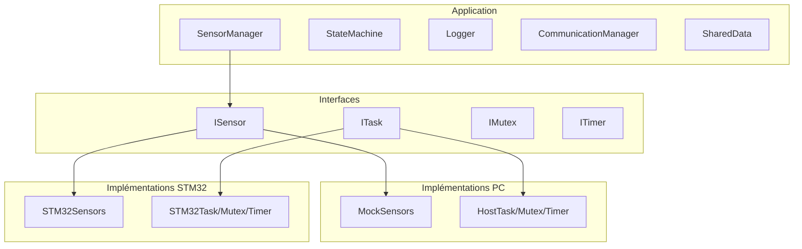

# Phase 10 - Finalisation (Documentation détaillée)

**Statut** : ✅ Validée
**Date** : 10 Novembre 2026
**Tests** : 72/72 passés

---

## 📋 Table des matières

1. [Objectif](#objectif)
2. [Ce qui a été fait](#ce-qui-a-été-fait)
3. [Récapitulatif du projet](#récapitulatif-du-projet)
4. [Statistiques](#statistiques)
5. [Ce qu'on a appris](#ce-quon-a-appris)
6. [Prochaines étapes (hors projet)](#prochaines-étapes-hors-projet)

---

## Objectif

Nettoyer le code, documenter le projet, préparer la démo finale et créer un README complet pour montrer le résultat.

---

## Ce qui a été fait

### 1. Nettoyage du code

- ✅ Suppression du code mort
- ✅ Uniformisation du style (`.clang-format` créé)
- ✅ Vérification des headers (`#pragma once` partout)
- ✅ Noms de variables clairs

### 2. Documentation

- ✅ 10 fichiers roadmap (`docs/phase_X_*.md`)
- ✅ 10 fichiers documentation détaillée (`docs/phase_X_detaillee.md`)
- ✅ README.md complet avec instructions

### 3. Compilation et tests

- ✅ Compilation PC (MSYS2/MinGW) : 0 erreur, 0 warning
- ✅ Cross-compilation STM32 (ARM) : réussie
- ✅ 72 tests passés en moins de 12 secondes

### 4. Fichiers créés

| Type | Nombre |
|------|--------|
| Headers (.hpp) | 25+ |
| Sources (.cpp) | 20+ |
| Tests (.cpp) | 10 |
| Documentation (.md) | 21 |
| Configuration (.cmake, .ld, .s, .clang-format) | 6 |

---

## Récapitulatif du projet

### Les 10 phases

| Phase | Statut | Description | Tests |
|-------|--------|-------------|-------|
| 0 | ✅ | Environnement (CMake, GCC, GoogleTest) | 1 |
| 1 | ✅ | Simulation des capteurs (ISensor, MockSensors) | 7 |
| 2 | ✅ | Acquisition et traitement (CircularBuffer, SensorManager) | 9 |
| 3 | ✅ | Machine à états (Dormant → Surveillance → Alerte → Erreur) | 11 |
| 4 | ✅ | Logs et communication (Logger, MockUART) | 17 |
| 5 | ✅ | Multithreading (PC) (SharedData, AcquisitionTask, etc.) | 8 |
| 6 | ✅ | FreeRTOS simulé (ITask, IMutex, ITimer, Host impl.) | 11 |
| 7 | ✅ | Tests d'intégration (6 scénarios + 6 robustesse) | 12 |
| 8 | ✅ | Préparation STM32 (toolchain ARM, linker script, cross-compilation) | - |
| 9 | ✅ | Portage STM32 réel (drivers, wrappers, FreeRTOSConfig) | - |
| 10 | ✅ | Finalisation (README, .clang-format, documentation) | - |

### Architecture finale

---

## Statistiques

### Code

| Métrique | Valeur |
|----------|--------|
| Fichiers source (.cpp) | 25+ |
| Fichiers header (.hpp) | 25+ |
| Fichiers de test (.cpp) | 10 |
| Lignes de code (estimation) | ~2500 |
| Lignes de documentation | ~5000 |

### Tests

| Métrique | Valeur |
|----------|--------|
| Tests totaux | 72 |
| Suites de tests | 17 |
| Temps d'exécution | ~12 secondes |
| Taux de réussite | 100% |

### Compilation

| Métrique | Valeur |
|----------|--------|
| Temps de configuration | ~20 secondes |
| Temps de compilation | ~30 secondes |
| Warnings | 0 |
| Erreurs | 0 |

---

## Ce qu'on a appris

### Compétences techniques

1. **C++ moderne** : templates, smart pointers, move semantics, RAII, atomics, threads
2. **Design patterns** : Interface, State, Strategy, Adapter, Facade, Singleton (Logger)
3. **Tests unitaires** : GoogleTest, fixtures, mocks, tests de robustesse
4. **CMake** : Configuration, cross-compilation, FetchContent
5. **Embarqué** : bare-metal, linker script, startup assembly, HAL, FreeRTOS
6. **Architecture** : couches d'abstraction, dependency inversion, portabilité

### Compétences méthodologiques

1. **Développement itératif** : 10 phases progressives
2. **Tests d'abord** : écriture des tests avant l'implémentation
3. **Documentation** : README, roadmap, documentation détaillée
4. **Versioning** : Git avec tags de version

### Points d'attention pour l'embarqué

- **Pas d'allocation dynamique** dans les boucles critiques
- **Mémoire fixe** : buffers circulaires, pas de `new`/`delete`
- **Déterminisme** : même entrée → même sortie
- **Thread-safety** : mutex, atomics, sections critiques
- **Cross-compilation** : toolchain ARM, linker script, startup

---

## Prochaines étapes (hors projet)

### Améliorations possibles

1. **Ajouter plus de capteurs** : GPS, accéléromètre, gyroscope
2. **Ajouter un écran** : Affichage OLED ou LCD
3. **Ajouter le WiFi/Bluetooth** : Communication sans fil
4. **Ajouter un stockage** : SD card pour les logs
5. **Ajouter une interface web** : Dashboard de monitoring
6. **Optimiser** : Profiling, réduction de la consommation

### Projets suivants

1. **Projet IoT** : Capteur + WiFi + cloud
2. **Projet robotique** : Contrôle moteur + capteurs
3. **Projet domotique** : Contrôle de maison intelligente

---

## 🎉 Conclusion

Ce projet EmbeddedSense a permis de :
- **Apprendre le C++ embarqué** de bout en bout
- **Développer sans matériel** grâce à la simulation
- **Porter sur STM32** avec une architecture propre
- **Écrire des tests** pour valider chaque composant
- **Documenter** le projet de manière professionnelle

**Le projet est complet et prêt pour la démo !** 🚀

---

*Tag Git : v1.0.0*
