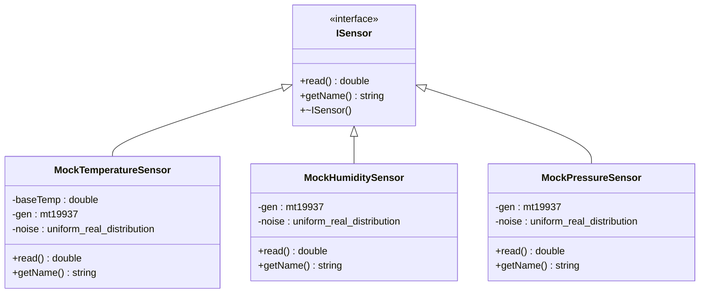
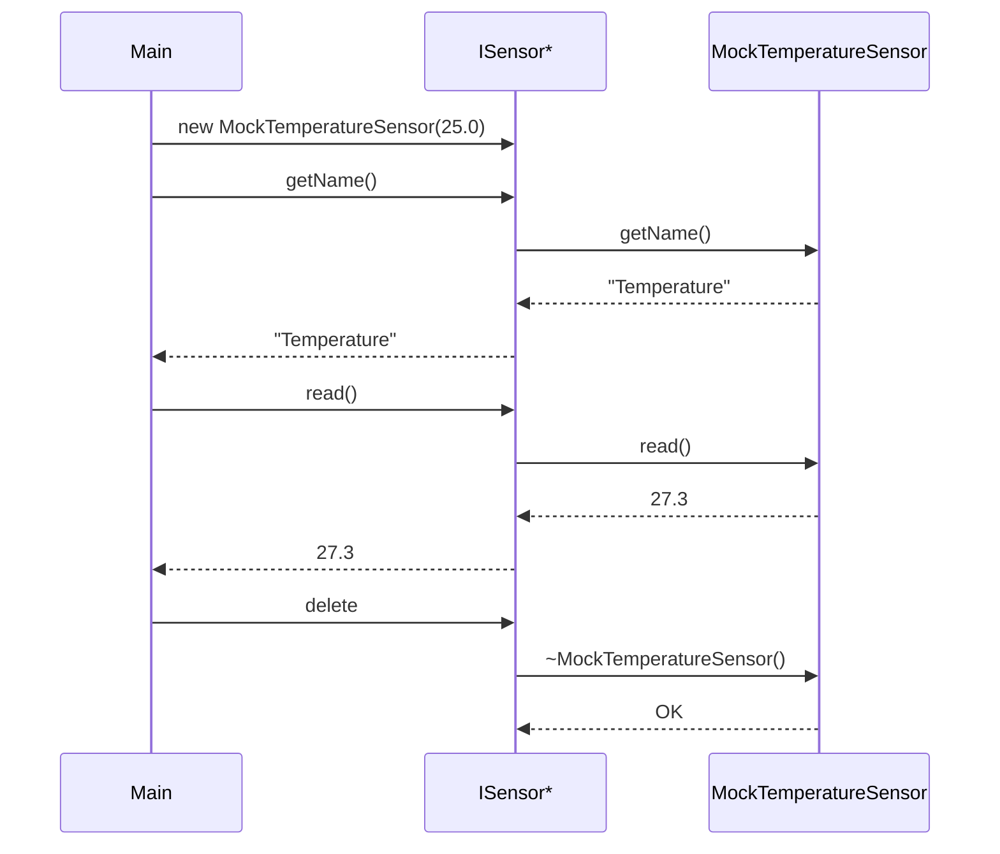

# Phase 1 - Simulation des capteurs (Documentation détaillée)

**Statut** : ✅ Validée
**Date** : 10 Novembre 2026
**Tests** : 8/8 passés

---

## 📋 Table des matières

1. [Objectif](#objectif)
2. [Architecture](#architecture)
3. [Notions clés](#notions-clés)
4. [Fichiers créés](#fichiers-créés)
5. [Explication du code](#explication-du-code)
6. [Tests unitaires](#tests-unitaires)
7. [Résultats des tests](#résultats-des-tests)
8. [Ce qu'on a appris](#ce-quon-a-appris)
9. [Prochaines étapes](#prochaines-étapes)

---

## Objectif

Créer des classes C++ qui **simulent** des capteurs physiques (température, humidité, pression) **sans matériel réel**. Ces classes serviront de base pour toute la suite du projet : acquisition, traitement, machine à états, etc.

### Pourquoi simuler ?

| Raison | Explication |
|--------|-------------|
| Pas de matériel | On peut développer et tester sans carte STM32 |
| Reproductibilité | Les résultats sont contrôlés et prédictibles |
| Rapidité | On peut simuler 1000 lectures en 1ms |
| Sécurité | On peut tester des cas extrêmes (capteur en panne, valeurs aberrantes) |

---

## Architecture



### Polymorphisme en action



### Principe : Interface + Implémentations

1. **ISensor** : définit le contrat ( ce qu'un capteur doit faire)
2. **MockXxxSensor** : implémente le contrat avec de la simulation

> **Avantage** : Dans les phases futures, on pourra remplacer `MockTemperatureSensor` par `STM32TemperatureSensor` sans changer le code qui utilise les capteurs, car ils respectent tous la même interface `ISensor`.

---

## Notions clés

### 1. Interface (classe abstraite)

Une **interface** est une classe qui ne contient que des méthodes virtuelles pures (`= 0`). Elle définit un **contrat** que toutes les classes qui l'implémentent doivent respecter.

```cpp
class ISensor {
public:
    virtual ~ISensor() = default;   // Destructeur virtuel (obligatoire pour polymorphisme)
    virtual double read() = 0;      // = 0 signifie "pure virtuelle" → doit être implémentée
    virtual std::string getName() = 0;
};
```

**Points clés :**
- `virtual` : permet le polymorphisme (appel dynamique)
- `= 0` : rend la méthode obligatoire pour les classes dérivées
- `virtual ~ISensor()` : **essentiel** pour pouvoir `delete` un objet via un pointeur de base sans fuite mémoire

### 2. Héritage et polymorphisme

```cpp
class MockTemperatureSensor : public ISensor {
    // Implémente toutes les méthodes virtuelles pures
    double read() override;
    std::string getName() override;
};
```

**Polymorphisme en action :**

```cpp
ISensor* sensor = new MockTemperatureSensor(25.0);
sensor->getName();  // Appelle MockTemperatureSensor::getName() → "Temperature"
sensor->read();     // Appelle MockTemperatureSensor::read()
delete sensor;      // Appelle ~MockTemperatureSensor() puis ~ISensor() (grâce au destructeur virtuel)
```

### 3. Générateur aléatoire

On utilise `std::mt19937` (Mersenne Twister) avec `std::uniform_real_distribution` :

```cpp
std::mt19937 gen(42);                    // Générateur avec seed fixe (reproductible)
std::uniform_real_distribution<double> noise(-5.0, 5.0);  // Plage [-5, +5]
double value = 25.0 + noise(gen);        // Résultat dans [20, 30]
```

**Pourquoi un seed fixe ?**
- Les tests sont **déterministes** : même seed → même séquence de nombres
- On peut reproduire exactement un bug si on le connaît
- Les tests ne "flakent" pas (pas de résultats aléatoires)

### 4. Encapsulation

Les attributs (`baseTemp`, `gen`, `noise`) sont **privés**. Le code externe ne peut pas les modifier directement, uniquement via les méthodes publiques (`read()`, `getName()`).

---

## Fichiers créés

### Structure des dossiers

```
drivers/
├── interfaces/
│   └── ISensor.hpp              ← Interface (contrat)
└── mock/
    ├── MockTemperatureSensor.hpp ← Déclaration
    ├── MockTemperatureSensor.cpp ← Implémentation
    ├── MockHumiditySensor.hpp
    ├── MockHumiditySensor.cpp
    ├── MockPressureSensor.hpp
    └── MockPressureSensor.cpp
tests/
├── test_main.cpp                ← Test existant (Phase 0)
└── test_sensors.cpp             ← 7 nouveaux tests
```

### Détail de chaque fichier

---

## Explication du code

### 1. `ISensor.hpp` — L'interface

```cpp
#pragma once
#include <string>

class ISensor {
public:
    virtual ~ISensor() = default;
    virtual double read() = 0;
    virtual std::string getName() = 0;
};
```

| Élément | Rôle |
|---------|------|
| `#pragma once` | Évite les inclusions multiples du même header |
| `virtual ~ISensor() = default` | Destructeur virtuel par défaut (polymorphisme sûr) |
| `virtual double read() = 0` | Méthode pure virtuelle → doit être implémentée |
| `virtual std::string getName() = 0` | Retourne le nom du capteur |

---

### 2. `MockTemperatureSensor.hpp/.cpp`

**Déclaration (`.hpp`) :**

```cpp
#pragma once
#include "drivers/interfaces/ISensor.hpp"
#include <random>

class MockTemperatureSensor : public ISensor {
private:
    double baseTemp;                              // Température de base (ex: 25°C)
    std::mt19937 gen;                             // Générateur aléatoire
    std::uniform_real_distribution<double> noise;  // Distribution de bruit [-5, +5]

public:
    MockTemperatureSensor(double baseTemp = 25.0, unsigned int seed = 42);
    double read() override;
    std::string getName() override;
};
```

**Implémentation (`.cpp`) :**

```cpp
#include "drivers/mock/MockTemperatureSensor.hpp"

MockTemperatureSensor::MockTemperatureSensor(double baseTemp, unsigned int seed)
    : baseTemp(baseTemp),              // Initialisation de baseTemp
      gen(seed),                      // Initialisation du générateur avec le seed
      noise(-5.0, 5.0)               // Distribution uniforme [-5, +5]
{
}

double MockTemperatureSensor::read() {
    return baseTemp + noise(gen);     // Valeur dans [baseTemp-5, baseTemp+5]
}

std::string MockTemperatureSensor::getName() {
    return "Temperature";
}
```

**Paramètres du constructeur :**

| Paramètre | Valeur par défaut | Description |
|-----------|-------------------|-------------|
| `baseTemp` | 25.0 | Température de base en °C |
| `seed` | 42 | Seed du générateur aléatoire (reproductible) |

**Plage de valeurs :** [baseTemp - 5, baseTemp + 5] = [20, 30] par défaut

---

### 3. `MockHumiditySensor.hpp/.cpp`

```cpp
// .hpp
class MockHumiditySensor : public ISensor {
private:
    std::mt19937 gen;
    std::uniform_real_distribution<double> noise;
public:
    MockHumiditySensor(unsigned int seed = 42);
    double read() override;
    std::string getName() override;
};

// .cpp
MockHumiditySensor::MockHumiditySensor(unsigned int seed)
    : gen(seed),
      noise(0.0, 100.0)    // Plage directe [0, 100] pour l'humidité
{
}

double MockHumiditySensor::read() {
    return noise(gen);       // Retourne directement [0, 100]
}

std::string MockHumiditySensor::getName() {
    return "Humidity";
}
```

**Plage de valeurs :** [0, 100] (%)

---

### 4. `MockPressureSensor.hpp/.cpp`

```cpp
// .hpp
class MockPressureSensor : public ISensor {
private:
    std::mt19937 gen;
    std::uniform_real_distribution<double> noise;
public:
    MockPressureSensor(unsigned int seed = 42);
    double read() override;
    std::string getName() override;
};

// .cpp
MockPressureSensor::MockPressureSensor(unsigned int seed)
    : gen(seed),
      noise(900.0, 1100.0)  // Plage directe [900, 1100] pour la pression
{
}

double MockPressureSensor::read() {
    return noise(gen);       // Retourne directement [900, 1100]
}

std::string MockPressureSensor::getName() {
    return "Pressure";
}
```

**Plage de valeurs :** [900, 1100] (hPa)

---

### 5. `CMakeLists.txt` — Mise à jour

```cmake
add_executable(embeddedsense_tests
  tests/test_main.cpp
  tests/test_sensors.cpp
  drivers/mock/MockTemperatureSensor.cpp
  drivers/mock/MockHumiditySensor.cpp
  drivers/mock/MockPressureSensor.cpp
)
target_include_directories(embeddedsense_tests PRIVATE ${CMAKE_SOURCE_DIR})
target_link_libraries(embeddedsense_tests gtest_main)
```

**Points clés :**
- `target_include_directories` : permet d'inclure les headers avec des chemins relatifs à la racine du projet
- Chaque `.cpp` de mock est compilé et lié au binaire de test
- Le header `.hpp` n'est pas compilé directement (il est inclus par les `.cpp`)

---

## Tests unitaires

### Fichier : `tests/test_sensors.cpp`

7 tests ont été écrits pour valider la Phase 1 :

#### Test 1 : `TemperatureName`
```cpp
TEST(SensorTest, TemperatureName) {
    MockTemperatureSensor sensor;
    EXPECT_EQ(sensor.getName(), "Temperature");
}
```
**Vérifie** : Le nom retourné est `"Temperature"`.

#### Test 2 : `TemperatureRange`
```cpp
TEST(SensorTest, TemperatureRange) {
    MockTemperatureSensor sensor(25.0);
    for (int i = 0; i < 1000; ++i) {
        double value = sensor.read();
        EXPECT_GE(value, 20.0);
        EXPECT_LE(value, 30.0);
    }
}
```
**Vérifie** : 1000 lectures successives restent dans [20, 30] (= 25 ± 5).

#### Test 3 : `HumidityName`
```cpp
TEST(SensorTest, HumidityName) {
    MockHumiditySensor sensor;
    EXPECT_EQ(sensor.getName(), "Humidity");
}
```

#### Test 4 : `HumidityRange`
```cpp
TEST(SensorTest, HumidityRange) {
    MockHumiditySensor sensor;
    for (int i = 0; i < 1000; ++i) {
        double value = sensor.read();
        EXPECT_GE(value, 0.0);
        EXPECT_LE(value, 100.0);
    }
}
```

#### Test 5 : `PressureName`
```cpp
TEST(SensorTest, PressureName) {
    MockPressureSensor sensor;
    EXPECT_EQ(sensor.getName(), "Pressure");
}
```

#### Test 6 : `PressureRange`
```cpp
TEST(SensorTest, PressureRange) {
    MockPressureSensor sensor;
    for (int i = 0; i < 1000; ++i) {
        double value = sensor.read();
        EXPECT_GE(value, 900.0);
        EXPECT_LE(value, 1100.0);
    }
}
```

#### Test 7 : `Polymorphism`
```cpp
TEST(SensorTest, Polymorphism) {
    ISensor* sensor = new MockTemperatureSensor(25.0);
    EXPECT_EQ(sensor->getName(), "Temperature");
    double value = sensor->read();
    EXPECT_GE(value, 20.0);
    EXPECT_LE(value, 30.0);
    delete sensor;
}
```
**Vérifie** : Le polymorphisme fonctionne correctement. On peut utiliser un `ISensor*` pour appeler les méthodes de `MockTemperatureSensor`. Le `delete` ne provoque pas de fuite mémoire grâce au destructeur virtuel.

### Macros GoogleTest utilisées

| Macro | Rôle |
|-------|------|
| `TEST(Suite, Name)` | Définit un test |
| `EXPECT_EQ(a, b)` | Vérifie l'égalité (continue si échec) |
| `EXPECT_GE(a, b)` | Vérifie a ≥ b (continue si échec) |
| `EXPECT_LE(a, b)` | Vérifie a ≤ b (continue si échec) |

> **EXPECT vs ASSERT** : `EXPECT_*` continue le test même en cas d'échec. `ASSERT_*` arrête immédiatement le test. On utilise `EXPECT` ici car on veut tester toutes les 1000 lectures même si une échoue.

---

## Résultats des tests

```
[==========] Running 8 tests from 2 test suites.
[----------] Global test environment set-up.
[----------] 7 tests from SensorTest
[ RUN      ] SensorTest.TemperatureName
[       OK ] SensorTest.TemperatureName (0 ms)
[ RUN      ] SensorTest.TemperatureRange
[       OK ] SensorTest.TemperatureRange (0 ms)
[ RUN      ] SensorTest.HumidityName
[       OK ] SensorTest.HumidityName (0 ms)
[ RUN      ] SensorTest.HumidityRange
[       OK ] SensorTest.HumidityRange (0 ms)
[ RUN      ] SensorTest.PressureName
[       OK ] SensorTest.PressureName (0 ms)
[ RUN      ] SensorTest.PressureRange
[       OK ] SensorTest.PressureRange (0 ms)
[ RUN      ] SensorTest.Polymorphism
[       OK ] SensorTest.Polymorphism (0 ms)
[----------] 7 tests from SensorTest (1 ms total)

[----------] 1 test from Phase0Test
[ RUN      ] Phase0Test.SimpleCheck
[       OK ] Phase0Test.SimpleCheck (0 ms)
[----------] 1 test from Phase0Test (1 ms total)

[----------] Global test environment tear-down.
[==========] 8 tests from 2 test suites ran. (1 ms total)
[  PASSED  ] 8 tests.
```

**Tous les tests passent en moins de 1ms.**

---

## Ce qu'on a appris

### Compétences acquises

1. **Interface abstraite (classe pure virtuelle)** : Définir un contrat que d'autres classes doivent respecter
2. **Héritage** : `class MockTemperatureSensor : public ISensor`
3. **Polymorphisme** : Utiliser un pointeur de base pour appeler des méthodes dérivées
4. **Destructeur virtuel** : Essentiel pour éviter les fuites mémoire avec le polymorphisme
5. **Générateur aléatoire** : `std::mt19937` + `std::uniform_real_distribution`
6. **Seed fixe** : Pour des tests déterministes et reproductibles
7. **Encapsulation** : Attributs privés, interface publique
8. **GoogleTest** : `TEST()`, `EXPECT_EQ`, `EXPECT_GE`, `EXPECT_LE`
9. **CMake** : Ajout de sources `.cpp` et d'includes
10. **Structure de projet** : Séparation `drivers/interfaces/` et `drivers/mock/`

### Patterns de design utilisés

| Pattern | Description |
|---------|-------------|
| **Interface** | `ISensor` définit le contrat |
| **Polymorphism** | `ISensor*` pointe vers n'importe quelle implémentation |
| **Mock** | Fausse implémentation pour les tests |
| **Dependency Injection** | Les capteurs sont injectés via `ISensor*` |

---

## Prochaines étapes

La **Phase 2** consistera à :
1. Créer un `CircularBuffer<T>` (buffer circulaire générique)
2. Créer un `SensorManager` qui gère plusieurs capteurs
3. Acquérir les données de tous les capteurs
4. Calculer des statistiques (moyenne, min, max)
5. Écrire les tests correspondants

---

## Commandes de référence

```bash
# Configurer (première fois ou après suppression de build/)
cmake -G "MSYS Makefiles" -S . -B build

# Compiler
cmake --build build

# Lancer les tests
cd build && ./embeddedsense_tests.exe

# Ou en une commande depuis la racine
cmake --build build && build/embeddedsense_tests.exe
```

---

