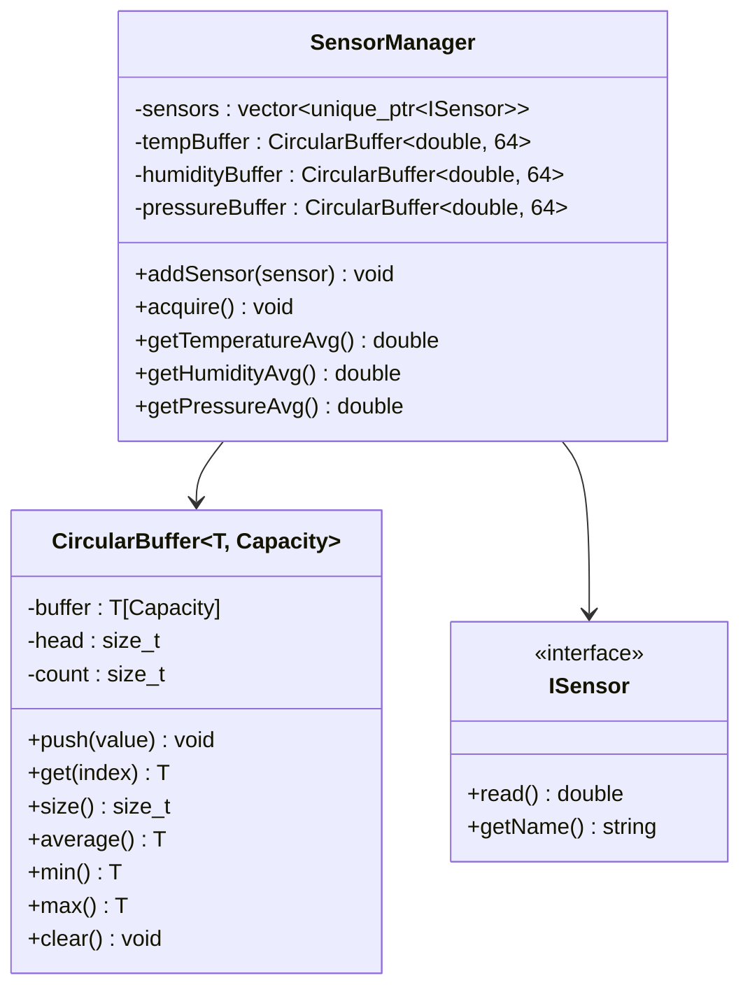
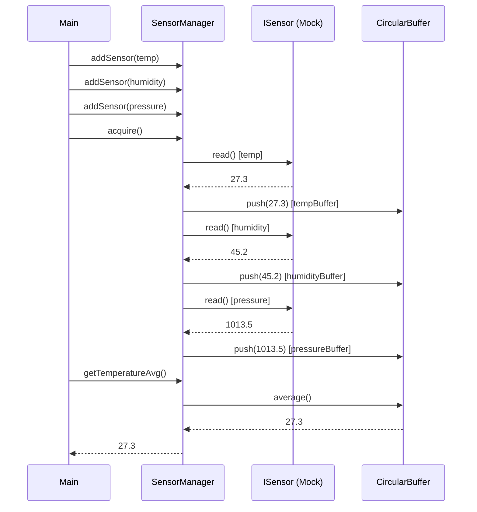

# Phase 2 - Acquisition et traitement (Documentation détaillée)

**Statut** : ✅ Validée
**Date** : 10 Novembre 2026
**Tests** : 17/17 passés

---

## 📋 Table des matières

1. [Objectif](#objectif)
2. [Architecture](#architecture)
3. [Notions clés](#notions-clés)
4. [CircularBuffer — Explication détaillée](#circularbuffer--explication-détaillée)
5. [SensorManager — Explication détaillée](#sensormanager--explication-détaillée)
6. [Fichiers créés](#fichiers-créés)
7. [Tests unitaires](#tests-unitaires)
8. [Résultats des tests](#résultats-des-tests)
9. [Ce qu'on a appris](#ce-quon-a-appris)
10. [Prochaines étapes](#prochaines-étapes)

---

## Objectif

Acquérir les données de **plusieurs capteurs** en même temps, les stocker dans une structure de données optimisée (buffer circulaire) et calculer des **statistiques** (moyenne, min, max).

### Pourquoi un buffer circulaire ?

Dans un système embarqué, la mémoire est **limitée**. On ne peut pas stocker toutes les valeurs indéfiniment. Le buffer circulaire résout ce problème :

| Approche | Mémoire | Avantage | Inconvénient |
|----------|---------|----------|-------------|
| Tableau infini | ∞ | Simple | Impossible en embarqué |
| Tableau fixe + shift | O(n) | Simple | Coûteux (décalage à chaque insertion) |
| **Buffer circulaire** | O(n) fixe | **O(1) par insertion**, pas de décalage | Légèrement plus complexe |

---

## Architecture



### Flux de données



---

## Notions clés

### 1. Template (générique)

Un **template** permet d'écrire du code qui fonctionne avec **n'importe quel type** :

```cpp
template<typename T, size_t Capacity>
class CircularBuffer { ... };
```

| Paramètre | Type | Description |
|-----------|------|-------------|
| `T` | Type | Le type des données stockées (int, double, float...) |
| `Capacity` | Valeur | La capacité maximale du buffer (connue à la compilation) |

**Utilisation :**

```cpp
CircularBuffer<int, 8> intBuf;       // Buffer de 8 entiers
CircularBuffer<double, 64> doubleBuf; // Buffer de 64 doubles
```

> **Avantage** : Le code est écrit une seule fois mais fonctionne pour tous les types. La capacité est déterminée à la compilation, donc pas d'allocation dynamique.

### 2. Buffer circulaire (Ring Buffer)

Un buffer circulaire est un tableau de taille fixe avec deux pointeurs :
- **head** : position d'écriture (prochaine case à écraser)
- **count** : nombre d'éléments actuellement stockés

**Comment ça marche :**

```
Capacité = 4

Push 10 :  [10, _, _, _]  head=1, count=1
Push 20 :  [10, 20, _, _]  head=2, count=2
Push 30 :  [10, 20, 30, _]  head=3, count=3
Push 40 :  [10, 20, 30, 40]  head=0, count=4  ← plein !
Push 50 :  [50, 20, 30, 40]  head=1, count=4  ← écrase le plus ancien (10)
```

**Formule de l'index de l'élément le plus ancien :**

```
oldest = (head + Capacity - count) % Capacity
```

### 3. Move semantics (std::move)

```cpp
void addSensor(std::unique_ptr<ISensor> sensor) {
    sensors.push_back(std::move(sensor));
}
```

`std::move` transfère la propriété du `unique_ptr` au vecteur. Sans `std::move`, le code ne compilerait pas car `unique_ptr` n'est pas copiable.

### 4. Moyenne glissante

La moyenne glissante lisse le signal en calculant la moyenne des N dernières valeurs :

```
Valeurs : [24.1, 24.3, 24.0, 24.5, 24.2]
Moyenne : (24.1 + 24.3 + 24.0 + 24.5 + 24.2) / 5 = 24.22
```

---

## CircularBuffer — Explication détaillée

### Fichier : `app/acquisition/CircularBuffer.hpp`

```cpp
#pragma once
#include <cstddef>
#include <stdexcept>

template<typename T, size_t Capacity>
class CircularBuffer {
private:
    T buffer[Capacity];    // Tableau fixe de taille Capacity
    size_t head = 0;      // Position d'écriture
    size_t count = 0;     // Nombre d'éléments stockés
```

### Méthode `push(T value)`

```cpp
void push(T value) {
    buffer[head] = value;              // Écrit la valeur à la position head
    head = (head + 1) % Capacity;      // Avance head (modulo pour boucler)
    if (count < Capacity) {
        ++count;                       // Incrémente count si pas plein
    }
}
```

**Complexité :** O(1) — une seule écriture, pas de décalage.

### Méthode `get(size_t index)`

```cpp
T get(size_t index) const {
    if (index >= count) {
        throw std::out_of_range("Index hors limites du CircularBuffer");
    }
    size_t oldest = (head + Capacity - count) % Capacity;
    return buffer[(oldest + index) % Capacity];
}
```

**Exemple avec Capacity=4, après push(10,20,30,40,50) :**

```
buffer = [50, 20, 30, 40]
head = 1, count = 4
oldest = (1 + 4 - 4) % 4 = 1
get(0) = buffer[(1+0)%4] = buffer[1] = 20  ← plus ancien
get(1) = buffer[(1+1)%4] = buffer[2] = 30
get(2) = buffer[(1+2)%4] = buffer[3] = 40
get(3) = buffer[(1+3)%4] = buffer[0] = 50  ← plus récent
```

### Méthode `average()`

```cpp
T average() const {
    if (count == 0) return T{};  // Buffer vide → valeur par défaut
    T sum = T{};
    for (size_t i = 0; i < count; ++i) {
        sum += get(i);
    }
    return sum / static_cast<T>(count);
}
```

**Note :** `static_cast<T>(count)` convertit `size_t` en `T` pour la division. Sans ce cast, la division entière tronquerait le résultat pour un type `int`.

### Méthodes `min()` et `max()`

```cpp
T min() const {
    if (count == 0) return T{};
    T m = get(0);
    for (size_t i = 1; i < count; ++i) {
        if (get(i) < m) m = get(i);
    }
    return m;
}
```

**Algorithme :** Initialisation avec le premier élément, puis parcours linéaire en comparant.

### Méthode `clear()`

```cpp
void clear() {
    head = 0;
    count = 0;
}
```

**Note :** On ne remet pas le tableau à zéro. Les anciennes valeurs seront écrasées par les prochains `push()`. C'est plus rapide.

---

## SensorManager — Explication détaillée

### Fichier : `app/acquisition/SensorManager.hpp`

```cpp
#pragma once
#include "drivers/interfaces/ISensor.hpp"
#include "CircularBuffer.hpp"
#include <vector>
#include <memory>
#include <string>

class SensorManager {
private:
    std::vector<std::unique_ptr<ISensor>> sensors;
    CircularBuffer<double, 64> tempBuffer;
    CircularBuffer<double, 64> humidityBuffer;
    CircularBuffer<double, 64> pressureBuffer;

public:
    void addSensor(std::unique_ptr<ISensor> sensor);
    void acquire();
    double getTemperatureAvg() const;
    double getHumidityAvg() const;
    double getPressureAvg() const;
    size_t getSensorCount() const;
};
```

### Fichier : `app/acquisition/SensorManager.cpp`

```cpp
#include "app/acquisition/SensorManager.hpp"

void SensorManager::addSensor(std::unique_ptr<ISensor> sensor) {
    sensors.push_back(std::move(sensor));
}
```

**`std::move`** : Transfère la propriété du `unique_ptr`. Le vecteur devient propriétaire du capteur.

```cpp
void SensorManager::acquire() {
    for (auto& sensor : sensors) {
        double value = sensor->read();
        std::string name = sensor->getName();
        if (name == "Temperature") {
            tempBuffer.push(value);
        } else if (name == "Humidity") {
            humidityBuffer.push(value);
        } else if (name == "Pressure") {
            pressureBuffer.push(value);
        }
    }
}
```

**Logique d'acquisition :**
1. Lire chaque capteur
2. Identifier le type par le nom
3. Pousser la valeur dans le buffer correspondant

```cpp
double SensorManager::getTemperatureAvg() const {
    return tempBuffer.average();
}
```

**Note :** `const` à la fin signifie que la méthode ne modifie pas l'objet. Cela permet d'appeler `getTemperatureAvg()` sur un `const SensorManager`.

---

## Fichiers créés

### Structure des dossiers

```
app/
└── acquisition/
    ├── CircularBuffer.hpp       ← Template (header only)
    ├── SensorManager.hpp        ← Déclaration
    └── SensorManager.cpp        ← Implémentation
tests/
├── test_main.cpp               ← Phase 0
├── test_sensors.cpp            ← Phase 1
└── test_acquisition.cpp        ← Phase 2 (9 tests)
```

### Détail des fichiers

| Fichier | Lignes | Rôle |
|---------|--------|------|
| `CircularBuffer.hpp` | ~80 | Buffer circulaire générique (template) |
| `SensorManager.hpp` | ~20 | Déclaration du gestionnaire |
| `SensorManager.cpp` | ~35 | Implémentation du gestionnaire |
| `test_acquisition.cpp` | ~100 | 9 tests unitaires |

---

## Tests unitaires

### Fichier : `tests/test_acquisition.cpp`

#### Tests CircularBuffer

##### Test 1 : `PushAndGet`
```cpp
TEST(CircularBufferTest, PushAndGet) {
    CircularBuffer<int, 4> buf;
    buf.push(10);
    buf.push(20);
    buf.push(30);
    EXPECT_EQ(buf.size(), 3u);
    EXPECT_EQ(buf.get(0), 10);
    EXPECT_EQ(buf.get(1), 20);
    EXPECT_EQ(buf.get(2), 30);
}
```
**Vérifie** : Les valeurs sont stockées et lues dans l'ordre FIFO.

##### Test 2 : `Average`
```cpp
TEST(CircularBufferTest, Average) {
    CircularBuffer<double, 8> buf;
    buf.push(10.0);
    buf.push(20.0);
    buf.push(30.0);
    EXPECT_DOUBLE_EQ(buf.average(), 20.0);
}
```
**Vérifie** : (10 + 20 + 30) / 3 = 20.0

##### Test 3 : `MinMax`
```cpp
TEST(CircularBufferTest, MinMax) {
    CircularBuffer<int, 8> buf;
    buf.push(5);
    buf.push(2);
    buf.push(8);
    buf.push(1);
    EXPECT_EQ(buf.min(), 1);
    EXPECT_EQ(buf.max(), 8);
}
```

##### Test 4 : `Overflow`
```cpp
TEST(CircularBufferTest, Overflow) {
    CircularBuffer<int, 3> buf;
    buf.push(1);
    buf.push(2);
    buf.push(3);
    buf.push(4);  // Écrase 1
    EXPECT_EQ(buf.size(), 3u);
    EXPECT_EQ(buf.get(0), 2);  // Le plus ancien est maintenant 2
    EXPECT_EQ(buf.get(1), 3);
    EXPECT_EQ(buf.get(2), 4);
}
```
**Vérifie** : Après dépassement de capacité, les anciennes valeurs sont écrasées et les nouvelles prennent leur place.

##### Test 5 : `EmptyBuffer`
```cpp
TEST(CircularBufferTest, EmptyBuffer) {
    CircularBuffer<double, 4> buf;
    EXPECT_EQ(buf.size(), 0u);
    EXPECT_DOUBLE_EQ(buf.average(), 0.0);
    EXPECT_DOUBLE_EQ(buf.min(), 0.0);
    EXPECT_DOUBLE_EQ(buf.max(), 0.0);
}
```
**Vérifie** : Un buffer vide retourne 0 pour toutes les statistiques.

##### Test 6 : `DoubleType`
```cpp
TEST(CircularBufferTest, DoubleType) {
    CircularBuffer<double, 4> buf;
    buf.push(1.5);
    buf.push(2.5);
    EXPECT_DOUBLE_EQ(buf.average(), 2.0);
}
```
**Vérifie** : Le template fonctionne avec le type `double`.

#### Tests SensorManager

##### Test 7 : `AddSensors`
```cpp
TEST(SensorManagerTest, AddSensors) {
    SensorManager mgr;
    mgr.addSensor(std::make_unique<MockTemperatureSensor>(25.0));
    mgr.addSensor(std::make_unique<MockHumiditySensor>());
    mgr.addSensor(std::make_unique<MockPressureSensor>());
    EXPECT_EQ(mgr.getSensorCount(), 3u);
}
```

##### Test 8 : `AcquireAndAvg`
```cpp
TEST(SensorManagerTest, AcquireAndAvg) {
    SensorManager mgr;
    mgr.addSensor(std::make_unique<MockTemperatureSensor>(25.0));
    mgr.addSensor(std::make_unique<MockHumiditySensor>());
    mgr.addSensor(std::make_unique<MockPressureSensor>());

    for (int i = 0; i < 10; ++i) {
        mgr.acquire();
    }

    double tempAvg = mgr.getTemperatureAvg();
    double humAvg = mgr.getHumidityAvg();
    double presAvg = mgr.getPressureAvg();

    EXPECT_GE(tempAvg, 20.0);
    EXPECT_LE(tempAvg, 30.0);
    EXPECT_GE(humAvg, 0.0);
    EXPECT_LE(humAvg, 100.0);
    EXPECT_GE(presAvg, 900.0);
    EXPECT_LE(presAvg, 1100.0);
}
```
**Vérifie** : Après 10 acquisitions, les moyennes sont dans les plages attendues.

##### Test 9 : `SingleAcquisition`
```cpp
TEST(SensorManagerTest, SingleAcquisition) {
    SensorManager mgr;
    mgr.addSensor(std::make_unique<MockTemperatureSensor>(25.0));
    mgr.acquire();
    double avg = mgr.getTemperatureAvg();
    EXPECT_GE(avg, 20.0);
    EXPECT_LE(avg, 30.0);
}
```

### Macros GoogleTest utilisées

| Macro | Rôle |
|-------|------|
| `EXPECT_EQ(a, b)` | Égalité (continue si échec) |
| `EXPECT_DOUBLE_EQ(a, b)` | Égalité double avec tolérance (continue si échec) |
| `EXPECT_GE(a, b)` | a ≥ b (continue si échec) |
| `EXPECT_LE(a, b)` | a ≤ b (continue si échec) |

---

## Résultats des tests

```
[==========] Running 17 tests from 4 test suites.
[----------] 6 tests from CircularBufferTest
[  PASSED  ] 6 tests.
[----------] 3 tests from SensorManagerTest
[  PASSED  ] 3 tests.
[----------] 7 tests from SensorTest
[  PASSED  ] 7 tests.
[----------] 1 test from Phase0Test
[  PASSED  ] 1 test.
[==========] 17 tests from 4 test suites ran. (3 ms total)
[  PASSED  ] 17 tests.
```

---

## Ce qu'on a appris

### Compétences acquises

1. **Template (générique)** : Écrire du code qui fonctionne pour n'importe quel type
2. **Buffer circulaire** : Structure de données O(1) pour l'insertion, mémoire fixe
3. **Move semantics** : `std::move` pour transférer la propriété des `unique_ptr`
4. **Moyenne glissante** : Lissage du signal par moyenne des N dernières valeurs
5. **Encapsulation** : Attributs privés, interface publique
6. **const correctness** : Méthodes `const` qui ne modifient pas l'objet
7. **CMake** : Ajout de nouveaux fichiers `.cpp` et `.hpp`
8. **Template header-only** : Les templates doivent être dans le `.hpp` (pas de `.cpp`)

### Patterns de design utilisés

| Pattern | Description |
|---------|-------------|
| **Template** | `CircularBuffer<T, Capacity>` générique |
| **Manager** | `SensorManager` centralise la gestion des capteurs |
| **Strategy** | Les capteurs sont interchangeables via `ISensor` |

### Points d'attention pour l'embarqué

- **Pas d'allocation dynamique** dans `CircularBuffer` (tableau statique)
- **Capacité fixe à la compilation** : pas de `new`/`delete`
- **O(1) par insertion** : pas de décalage de tableau
- **Mémoire prévisible** : `sizeof(CircularBuffer<double, 64>)` = 64 × 8 + 16 = 528 octets

---

## Prochaines étapes

La **Phase 3** consistera à :
1. Créer une machine à états finis (FSM)
2. 4 états : Dormant, Surveillance, Alerte, Erreur
3. Transitions par événements (START, TIMEOUT, THRESHOLD_EXCEEDED, ERROR, RESET)
4. Pattern State (chaque état = classe dédiée)
5. Écrire les tests pour toutes les transitions

---

## Commandes de référence

```bash
# Compiler
cmake --build build

# Lancer les tests
cd build && ./embeddedsense_tests.exe

# Ou en une commande depuis la racine
cmake --build build && build/embeddedsense_tests.exe
```

---

