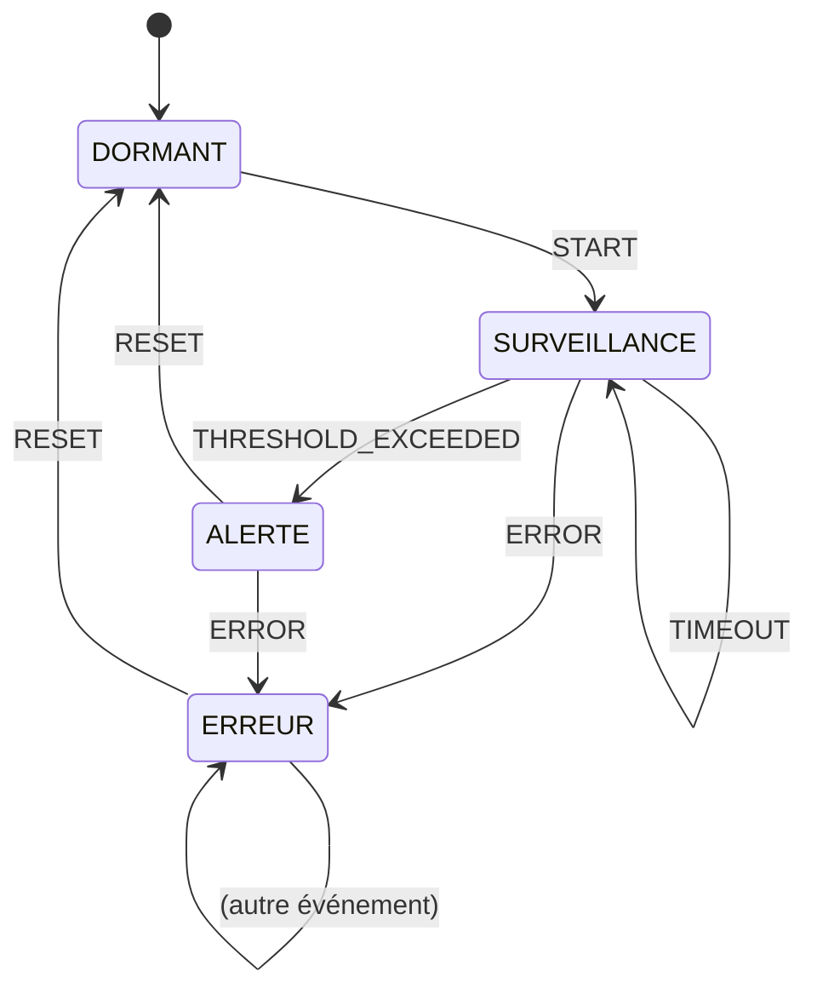
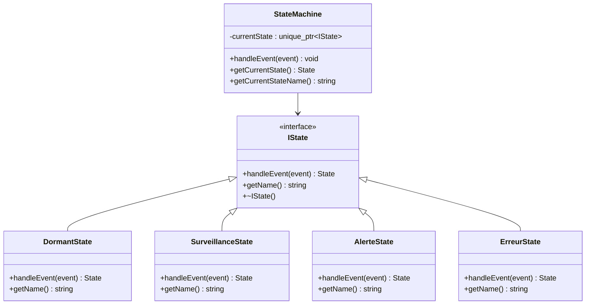

# Phase 3 - Machine à états (Documentation détaillée)

**Statut** : ✅ Validée
**Date** : 10 Novembre 2026
**Tests** : 28/28 passés

---

## 📋 Table des matières

1. [Objectif](#objectif)
2. [Architecture](#architecture)
3. [Notions clés](#notions-clés)
4. [Types — State et Event](#types--state-et-event)
5. [Interface IState](#interface-istate)
6. [Les 4 états](#les-4-états)
7. [StateMachine — Le contexte](#statemachine--le-contexte)
8. [Fichiers créés](#fichiers-créés)
9. [Tests unitaires](#tests-unitaires)
10. [Résultats des tests](#résultats-des-tests)
11. [Ce qu'on a appris](#ce-quon-a-appris)
12. [Prochaines étapes](#prochaines-étapes)

---

## Objectif

Implémenter une **machine à états finis (FSM)** qui gère les **modes de fonctionnement** du système embarqué. Le système est toujours dans **un seul état** à la fois, et des événements provoquent des transitions d'un état à un autre.

### Les 4 états du système

| État | Signification | LED (futur STM32) |
|------|--------------|-------------------|
| **DORMANT** | Système en veille, économie d'énergie | LED éteinte |
| **SURVEILLANCE** | Acquisition active, tout va bien | LED verte |
| **ALERTE** | Seuil dépassé, attention requise | LED rouge |
| **ERREUR** | Panne détectée, intervention nécessaire | LED rouge clignotante |

### Pourquoi une machine à états ?

| Sans FSM | Avec FSM |
|----------|----------|
| `if/else` imbriqués illisibles | États clairement définis |
| Transitions implicites | Transitions explicites et documentées |
| Difficile à tester | Chaque transition testable unitairement |
| Bug-prone | Déterministe et prévisible |

---

## Architecture



### Pattern State



---

## Notions clés

### 1. Machine à états finis (FSM)

Une FSM est un modèle où :
- Le système est **toujours dans un seul état**
- Des **événements** provoquent des **transitions** entre états
- Les transitions sont **déterministes** : même état + même événement = même résultat

**Formalisme :**

```
FSM = (États, Événements, Transitions, État initial)
```

### 2. Pattern State

Au lieu d'utiliser des `if/else` ou `switch` géants, chaque état devient une **classe** qui implémente une interface commune (`IState`). Le contexte (`StateMachine`) délègue le comportement à l'état courant.

**Avantages :**
- Code modulaire : ajouter un état = ajouter une classe
- Testable : chaque état testable indépendamment
- Extensible : Open/Closed Principle (ouvert à l'extension, fermé à la modification)

### 3. Enum class (énumération typée)

```cpp
enum class State : uint8_t {
    DORMANT, SURVEILLANCE, ALERTE, ERREUR
};
```

**Pourquoi `enum class` et pas `enum` ?**

| `enum` classique | `enum class` |
|-----------------|-------------|
| Valeurs dans l'espace global | Valeurs dans l'espace de l'enum |
| Conversion implicite en int | Pas de conversion implicite |
| Peut être confondu avec d'autres enums | Type-safe |
| `State::DORMANT` ou `DORMANT` | Obligatoirement `State::DORMANT` |

`uint8_t` : on force le type sous-jacent à 1 octet (économie de mémoire en embarqué).

### 4. Délégation (Delegation Pattern)

```cpp
void StateMachine::handleEvent(Event event) {
    State nextState = currentState->handleEvent(event);  // Délègue à l'état
    if (nextState != getCurrentState()) {
        // Transition : crée le nouvel état
    }
}
```

La `StateMachine` ne connaît pas la logique de chaque état. Elle délègue à l'objet `currentState` (qui est un `IState*`).

---

## Types — State et Event

### Fichier : `app/control/Types.hpp`

```cpp
#pragma once
#include <cstdint>

enum class State : uint8_t {
    DORMANT,
    SURVEILLANCE,
    ALERTE,
    ERREUR
};

enum class Event : uint8_t {
    START,
    TIMEOUT,
    THRESHOLD_EXCEEDED,
    ERROR,
    RESET
};
```

**Les 5 événements :**

| Événement | Signification | Déclencheur |
|-----------|--------------|-------------|
| `START` | Démarrer la surveillance | Bouton utilisateur ou commande UART |
| `TIMEOUT` | Timer d'acquisition expiré | Timer périodique |
| `THRESHOLD_EXCEEDED` | Seuil dépassé | Valeur capteur > seuil |
| `ERROR` | Erreur détectée | Capteur en panne, erreur communication |
| `RESET` | Réinitialisation | Commande utilisateur |

---

## Interface IState

### Fichier : `app/control/IState.hpp`

```cpp
#pragma once
#include "Types.hpp"
#include <string>

class IState {
public:
    virtual ~IState() = default;
    virtual State handleEvent(Event event) = 0;
    virtual std::string getName() const = 0;
};
```

| Méthode | Rôle |
|---------|------|
| `handleEvent(event)` | Traite un événement et retourne le nouvel état |
| `getName()` | Retourne le nom de l'état (pour le debug/logging) |
| `~IState()` | Destructeur virtuel (polymorphisme sûr) |

**Note :** `handleEvent` retourne un `State` (pas un `IState*`). C'est la `StateMachine` qui se charge de créer le bon objet état.

---

## Les 4 états

### 1. DormantState

**Fichier :** `app/control/DormantState.hpp/.cpp`

```cpp
State DormantState::handleEvent(Event event) {
    if (event == Event::START) {
        return State::SURVEILLANCE;
    }
    return State::DORMANT;  // Reste en Dormant pour tout autre événement
}
```

**Comportement :**
- `START` → passe en SURVEILLANCE
- Tout autre événement → reste en DORMANT

### 2. SurveillanceState

**Fichier :** `app/control/SurveillanceState.hpp/.cpp`

```cpp
State SurveillanceState::handleEvent(Event event) {
    switch (event) {
        case Event::THRESHOLD_EXCEEDED:
            return State::ALERTE;
        case Event::ERROR:
            return State::ERREUR;
        default:
            return State::SURVEILLANCE;  // TIMEOUT, START, RESET → reste
    }
}
```

**Comportement :**
- `THRESHOLD_EXCEEDED` → passe en ALERTE
- `ERROR` → passe en ERREUR
- Tout autre événement (TIMEOUT, START, RESET) → reste en SURVEILLANCE

### 3. AlerteState

**Fichier :** `app/control/AlerteState.hpp/.cpp`

```cpp
State AlerteState::handleEvent(Event event) {
    if (event == Event::RESET) {
        return State::DORMANT;
    }
    if (event == Event::ERROR) {
        return State::ERREUR;
    }
    return State::ALERTE;  // Reste en Alerte
}
```

**Comportement :**
- `RESET` → retour en DORMANT
- `ERROR` → passe en ERREUR
- Tout autre événement → reste en ALERTE

### 4. ErreurState

**Fichier :** `app/control/ErreurState.hpp/.cpp`

```cpp
State ErreurState::handleEvent(Event event) {
    if (event == Event::RESET) {
        return State::DORMANT;
    }
    return State::ERREUR;  // Reste en Erreur
}
```

**Comportement :**
- `RESET` → retour en DORMANT
- Tout autre événement → reste en ERREUR

### Tableau récapitulatif des transitions

| État courant | START | TIMEOUT | THRESHOLD_EXCEEDED | ERROR | RESET |
|-------------|-------|---------|-------------------|-------|-------|
| **DORMANT** | → SURVEILLANCE | → DORMANT | → DORMANT | → DORMANT | → DORMANT |
| **SURVEILLANCE** | → SURVEILLANCE | → SURVEILLANCE | → ALERTE | → ERREUR | → SURVEILLANCE |
| **ALERTE** | → ALERTE | → ALERTE | → ALERTE | → ERREUR | → DORMANT |
| **ERREUR** | → ERREUR | → ERREUR | → ERREUR | → ERREUR | → DORMANT |

---

## StateMachine — Le contexte

### Fichier : `app/control/StateMachine.hpp/.cpp`

```cpp
class StateMachine {
private:
    std::unique_ptr<IState> currentState;

public:
    StateMachine();
    void handleEvent(Event event);
    State getCurrentState() const;
    std::string getCurrentStateName() const;
};
```

### Constructeur

```cpp
StateMachine::StateMachine()
    : currentState(std::make_unique<DormantState>()) {
}
```

**L'état initial est toujours DORMANT.**

### Méthode `handleEvent(Event event)`

```cpp
void StateMachine::handleEvent(Event event) {
    State nextState = currentState->handleEvent(event);
    if (nextState != getCurrentState()) {
        switch (nextState) {
            case State::DORMANT:
                currentState = std::make_unique<DormantState>();
                break;
            case State::SURVEILLANCE:
                currentState = std::make_unique<SurveillanceState>();
                break;
            case State::ALERTE:
                currentState = std::make_unique<AlerteState>();
                break;
            case State::ERREUR:
                currentState = std::make_unique<ErreurState>();
                break;
        }
    }
}
```

**Logique :**
1. Déléguer l'événement à l'état courant → obtenir le nouvel état
2. Si le nouvel état est différent de l'actuel → transition
3. Créer une nouvelle instance de l'état correspondant

**Pourquoi recréer l'objet état ?**
- Chaque état est **sans état interne** (stateless) → on peut en créer un nouveau à chaque transition
- C'est plus simple que de gérer un pool d'objets
- Le `unique_ptr` garantit qu'il n'y a qu'un seul état actif à la fois

### Méthode `getCurrentState()`

```cpp
State StateMachine::getCurrentState() const {
    std::string name = currentState->getName();
    if (name == "Dormant") return State::DORMANT;
    if (name == "Surveillance") return State::SURVEILLANCE;
    if (name == "Alerte") return State::ALERTE;
    if (name == "Erreur") return State::ERREUR;
    return State::DORMANT;
}
```

**Note :** On déduit l'état à partir du nom. C'est une approche simple et sûre. Une alternative serait de stocker un `State` dans la `StateMachine`, mais cela créerait une redondance avec l'objet état.

---

## Fichiers créés

### Structure des dossiers

```
app/
└── control/
    ├── Types.hpp                  ← Enums State et Event
    ├── IState.hpp                 ← Interface
    ├── DormantState.hpp/.cpp      ← État Dormant
    ├── SurveillanceState.hpp/.cpp  ← État Surveillance
    ├── AlerteState.hpp/.cpp        ← État Alerte
    ├── ErreurState.hpp/.cpp        ← État Erreur
    ├── StateMachine.hpp           ← Déclaration
    └── StateMachine.cpp           ← Implémentation
tests/
└── test_state_machine.cpp         ← 11 tests
```

### Détail des fichiers

| Fichier | Lignes | Rôle |
|---------|--------|------|
| `Types.hpp` | ~15 | Enums State et Event |
| `IState.hpp` | ~12 | Interface IState |
| `DormantState.hpp/.cpp` | ~15 | État Dormant |
| `SurveillanceState.hpp/.cpp` | ~20 | État Surveillance |
| `AlerteState.hpp/.cpp` | ~18 | État Alerte |
| `ErreurState.hpp/.cpp` | ~15 | État Erreur |
| `StateMachine.hpp/.cpp` | ~45 | Contexte FSM |
| `test_state_machine.cpp` | ~90 | 11 tests |

---

## Tests unitaires

### Fichier : `tests/test_state_machine.cpp`

11 tests couvrent toutes les transitions :

| Test | Scénario | Résultat attendu |
|------|----------|-------------------|
| `InitialState` | État initial | DORMANT |
| `DormantToSurveillance` | START depuis DORMANT | SURVEILLANCE |
| `SurveillanceToAlerte` | THRESHOLD_EXCEEDED depuis SURVEILLANCE | ALERTE |
| `SurveillanceToErreur` | ERROR depuis SURVEILLANCE | ERREUR |
| `AlerteToDormant` | RESET depuis ALERTE | DORMANT |
| `AlerteToErreur` | ERROR depuis ALERTE | ERREUR |
| `ErreurToDormant` | RESET depuis ERREUR | DORMANT |
| `InvalidTransitionIgnored` | Événement invalide | Reste dans le même état |
| `FullCycle` | Cycle complet | DORMANT → SURVEILLANCE → ALERTE → DORMANT |
| `SurveillanceStaysOnTimeout` | TIMEOUT depuis SURVEILLANCE | SURVEILLANCE |
| `ErrorFromAnyState` | ERROR depuis SURVEILLANCE et ALERTE | ERREUR |

### Exemple de test : `FullCycle`

```cpp
TEST(StateMachineTest, FullCycle) {
    StateMachine fsm;
    EXPECT_EQ(fsm.getCurrentState(), State::DORMANT);

    fsm.handleEvent(Event::START);
    EXPECT_EQ(fsm.getCurrentState(), State::SURVEILLANCE);

    fsm.handleEvent(Event::THRESHOLD_EXCEEDED);
    EXPECT_EQ(fsm.getCurrentState(), State::ALERTE);

    fsm.handleEvent(Event::RESET);
    EXPECT_EQ(fsm.getCurrentState(), State::DORMANT);
}
```

**Ce test valide le scénario complet :**
1. Système en veille (DORMANT)
2. Démarrage → surveillance active (SURVEILLANCE)
3. Seuil dépassé → alerte (ALERTE)
4. Reset → retour en veille (DORMANT)

---

## Résultats des tests

```
[==========] Running 28 tests from 5 test suites.
[----------] 11 tests from StateMachineTest
[  PASSED  ] 11 tests.
[----------] 6 tests from CircularBufferTest
[  PASSED  ] 6 tests.
[----------] 3 tests from SensorManagerTest
[  PASSED  ] 3 tests.
[----------] 7 tests from SensorTest
[  PASSED  ] 7 tests.
[----------] 1 test from Phase0Test
[  PASSED  ] 1 test.
[==========] 28 tests from 5 test suites ran. (2 ms total)
[  PASSED  ] 28 tests.
```

---

## Ce qu'on a appris

### Compétences acquises

1. **Machine à états finis (FSM)** : Modèle pour gérer les modes d'un système
2. **Pattern State** : Chaque état est une classe dédiée
3. **Enum class** : Énumération typée et sécurisée (type-safe)
4. **Délégation** : Le contexte délègue le comportement à l'état courant
5. **Polymorphisme** : `IState*` pointe vers n'importe quel état
6. **unique_ptr** : Gestion automatique de la mémoire
7. **Switch sur enum** : Branchement exhaustif sur les valeurs d'un enum
8. **GoogleTest** : `EXPECT_EQ` pour comparer des enums
9. **CMake** : Ajout de nouveaux fichiers `.cpp` dans `app/control/`

### Patterns de design utilisés

| Pattern | Description |
|---------|-------------|
| **State** | Chaque état est une classe qui implémente `IState` |
| **Delegation** | `StateMachine` délègue à `currentState` |
| **Polymorphism** | `IState*` permet de traiter tous les états uniformément |

### Points d'attention pour l'embarqué

- **Pas d'allocation dynamique dans la boucle** : les `make_unique` sont uniquement lors des transitions (rares)
- **État sans données internes** : les états sont stateless, donc pas de mémoire à gérer
- **Enum sur 1 octet** : `uint8_t` pour minimiser l'empreinte mémoire
- **Déterminisme** : même entrée → même sortie, essentiel pour le temps réel

---

## Prochaines étapes

La **Phase 4** consistera à :
1. Créer un Logger avec niveaux (DEBUG, INFO, WARN, ERROR)
2. Créer un MockUART pour simuler la communication série
3. Créer un CommunicationManager qui lie Logger + UART
4. Écrire les tests pour le logging et la communication

---

## Commandes de référence

```bash
# Compiler
cmake --build build

# Lancer les tests
cd build && ./embeddedsense_tests.exe

# Ou en une commande depuis la racine
cmake --build build && build/embeddedsense_tests.exe
```

---

