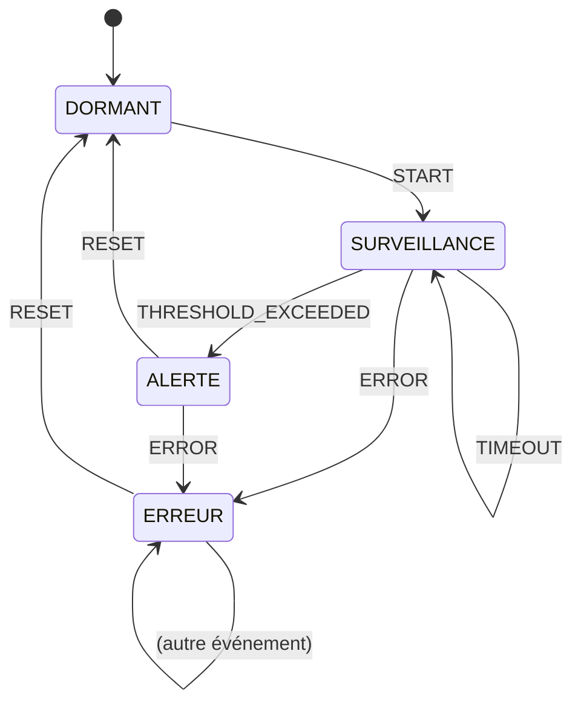

# Phase 3 - Machine à états

**Objectif** : Implémenter une machine à états finis (FSM) qui gère les modes du système (dormant, surveillance, alerte, erreur).

---

## 🧠 Notions clés

- **Machine à états finis (FSM)** : Un modèle où le système est toujours dans UN seul état. Des transitions (événements) font passer d'un état à un autre.
- **State Pattern** : Chaque état est une classe dédiée. Le contexte délègue le comportement à l'état courant.
- **Déterminisme** : Même état + même événement = toujours le même état suivant.

---

## Architecture



---

## 🛠️ Étapes à réaliser

### 1. Définir les types

Créer `app/control/Types.hpp` :

```cpp
#pragma once
#include <cstdint>

enum class State : uint8_t { DORMANT, SURVEILLANCE, ALERTE, ERREUR };
enum class Event : uint8_t { START, TIMEOUT, THRESHOLD_EXCEEDED, ERROR, RESET };
```

### 2. Créer l'interface `IState`

Créer `app/control/IState.hpp` :

```cpp
#pragma once
#include "Types.hpp"
#include <string>

class IState {
public:
    virtual ~IState() = default;
    virtual State handleEvent(Event event) = 0;
    virtual std::string getName() const = 0;
};
```

### 3. Implémenter chaque état

| Fichier | État | Comportement |
|---------|------|-------------|
| `DormantState.cpp` | Dormant | `START` → SURVEILLANCE, reste sinon |
| `SurveillanceState.cpp` | Surveillance | `THRESHOLD_EXCEEDED` → ALERTE, `ERROR` → ERREUR |
| `AlerteState.cpp` | Alerte | `RESET` → DORMANT, `ERROR` → ERREUR |
| `ErreurState.cpp` | Erreur | `RESET` → DORMANT, reste sinon |

### 4. Créer `StateMachine`

Créer `app/control/StateMachine.hpp` et `.cpp` :

```cpp
#pragma once
#include "IState.hpp"
#include <memory>

class StateMachine {
private:
    std::unique_ptr<IState> currentState;
public:
    StateMachine();
    void handleEvent(Event event);
    State getCurrentState() const;
    std::string getCurrentStateName() const;
};
```

### 5. Écrire les tests

| Test | Scénario |
|------|----------|
| `Dormant_to_Surveillance` | START → état change |
| `Surveillance_to_Alerte` | THRESHOLD_EXCEEDED → état change |
| `AnyState_to_Erreur` | ERROR depuis n'importe quel état |
| `Erreur_to_Dormant` | RESET depuis erreur → Dormant |
| `InvalidTransition` | Événement ignoré → reste dans le même état |
| `FullCycle` | Dormant → Surveillance → Alerte → Reset → Dormant |

### 6. Mettre à jour CMakeLists.txt

---

## ✅ Checklist de validation

- [ ] 4 états implémentés (Dormant, Surveillance, Alerte, Erreur)
- [ ] Toutes les transitions du diagramme fonctionnent
- [ ] Événements invalides sont ignorés (pas de crash)
- [ ] 6+ tests unitaires passent
- [ ] `cmake --build build && cd build && ctest` : tous les tests passent

---

## 📁 Fichiers à créer/modifier

| Fichier | Action |
|---------|--------|
| `app/control/Types.hpp` | Créer |
| `app/control/IState.hpp` | Créer |
| `app/control/StateMachine.hpp` | Créer |
| `app/control/StateMachine.cpp` | Créer |
| `app/control/DormantState.hpp/.cpp` | Créer |
| `app/control/SurveillanceState.hpp/.cpp` | Créer |
| `app/control/AlerteState.hpp/.cpp` | Créer |
| `app/control/ErreurState.hpp/.cpp` | Créer |
| `tests/test_state_machine.cpp` | Créer |
| `CMakeLists.txt` | Modifier |
