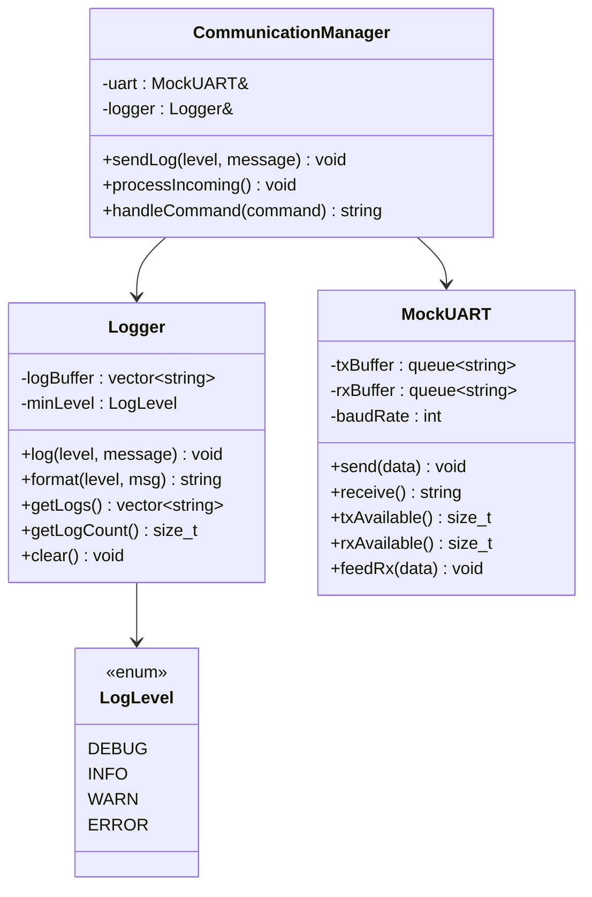
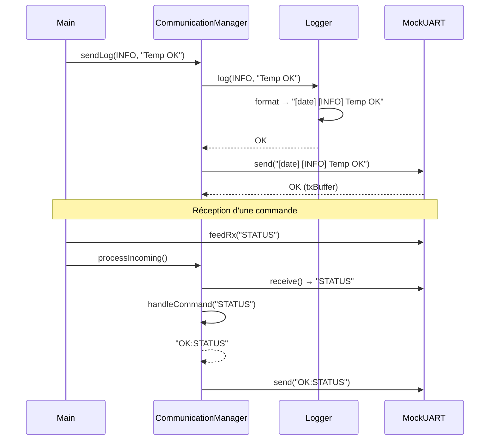

# Phase 4 - Logs et communication (Documentation détaillée)

**Statut** : ✅ Validée
**Date** : 10 Novembre 2026
**Tests** : 43/43 passés

---

## 📋 Table des matières

1. [Objectif](#objectif)
2. [Architecture](#architecture)
3. [Notions clés](#notions-clés)
4. [LogLevel — Les niveaux de log](#loglevel--les-niveaux-de-log)
5. [Logger — Le service de log](#logger--le-service-de-log)
6. [MockUART — La communication série simulée](#mockuart--la-communication-série-simulée)
7. [CommunicationManager — Le lien Logger + UART](#communicationmanager--le-lien-logger--uart)
8. [Fichiers créés](#fichiers-créés)
9. [Tests unitaires](#tests-unitaires)
10. [Résultats des tests](#résultats-des-tests)
11. [Ce qu'on a appris](#ce-quon-a-appris)
12. [Prochaines étapes](#prochaines-étapes)

---

## Objectif

Systématiser les **messages de log** (debug, info, erreur) avec des niveaux et un horodatage, et **simuler la communication série (UART)** entre le système et un terminal distant.

### Pourquoi les logs ?

| Sans logs | Avec logs |
|-----------|-----------|
| Impossible de savoir ce qui se passe | Chaque événement est tracé |
| Debugging à l'aveugle | Historique complet des actions |
| Pas de diagnostic à distance | Monitoring en temps réel via UART |

### Pourquoi simuler l'UART ?

L'UART est le protocole de communication le plus utilisé dans l'embarqué (90% des cartes). On le simule côté PC pour développer et tester sans matériel.

---

## Architecture



### Flux de communication



---

## Notions clés

### 1. Niveaux de log (Log Levels)

Les niveaux de log permettent de **filtrer** les messages selon leur importance :

| Niveau | Valeur | Usage |
|--------|--------|-------|
| `DEBUG` | 0 | Détails de debug (variables, états internes) |
| `INFO` | 1 | Informations générales (démarrage, acquisition) |
| `WARN` | 2 | Avertissements (valeur proche du seuil) |
| `ERROR` | 3 | Erreurs (capteur en panne, erreur communication) |

**Filtrage :** Si `minLevel = WARN`, seuls les messages `WARN` et `ERROR` sont enregistrés. Les `DEBUG` et `INFO` sont ignorés.

### 2. Horodatage (Timestamp)

Chaque message de log est préfixé par la date et l'heure :

```
[2026-11-10 15:30:45] [INFO] Temperature OK: 24.5°C
```

Cela permet de :
- Corréler les événements dans le temps
- Diagnostiquer des problèmes intermittents
- Tracer la séquence d'événements

### 3. Communication série (UART)

L'UART (Universal Asynchronous Receiver/Transmitter) est un protocole de communication série :

| Paramètre | Valeur typique |
|-----------|---------------|
| Baud rate | 115200 bps |
| Data bits | 8 |
| Stop bits | 1 |
| Parité | Aucune |

**Dans notre simulation :**
- `txBuffer` = données envoyées par le système
- `rxBuffer` = données reçues par le système
- `baudRate` = vitesse de transmission (stockée mais pas utilisée en simulation)

### 4. File d'attente (Queue)

On utilise `std::queue` (FIFO) pour simuler les buffers de transmission/réception :

```
send("A") → txBuffer: [A]
send("B") → txBuffer: [A, B]
receive() → "A", txBuffer: [B]
```

---

## LogLevel — Les niveaux de log

### Fichier : `services/logger/LogLevel.hpp`

```cpp
#pragma once
#include <cstdint>

enum class LogLevel : uint8_t {
    DEBUG,
    INFO,
    WARN,
    ERROR
};
```

**Pourquoi `enum class` et pas `enum` ?**
- Type-safe : pas de conversion implicite en int
- Valeurs dans l'espace de l'enum : `LogLevel::DEBUG` obligatoire
- `uint8_t` : 1 octet en mémoire (économie en embarqué)

---

## Logger — Le service de log

### Fichier : `services/logger/Logger.hpp`

```cpp
#pragma once
#include "LogLevel.hpp"
#include <vector>
#include <string>
#include <ctime>

class Logger {
private:
    std::vector<std::string> logBuffer;
    LogLevel minLevel;

    std::string levelToString(LogLevel level) const;
    std::string getCurrentTime() const;

public:
    Logger(LogLevel minLevel = LogLevel::INFO);
    void log(LogLevel level, const std::string& message);
    std::string format(LogLevel level, const std::string& msg) const;
    const std::vector<std::string>& getLogs() const;
    size_t getLogCount() const;
    void clear();
    LogLevel getMinLevel() const;
};
```

### Fichier : `services/logger/Logger.cpp`

#### Constructeur

```cpp
Logger::Logger(LogLevel minLevel)
    : minLevel(minLevel)
{
}
```

**Paramètre par défaut :** `LogLevel::INFO` (si non spécifié)

#### Méthode `log(LogLevel level, const std::string& message)`

```cpp
void Logger::log(LogLevel level, const std::string& message) {
    if (static_cast<uint8_t>(level) < static_cast<uint8_t>(minLevel)) {
        return;  // Niveau trop bas, on ignore
    }
    std::string formatted = format(level, message);
    logBuffer.push_back(formatted);
}
```

**Logique de filtrage :**
1. Convertir les enums en `uint8_t` pour la comparaison
2. Si `level < minLevel` → ignorer (ne rien faire)
3. Sinon → formater et stocker dans le buffer

#### Méthode `format(LogLevel level, const std::string& msg)`

```cpp
std::string Logger::format(LogLevel level, const std::string& msg) const {
    std::ostringstream oss;
    oss << "[" << getCurrentTime() << "] "
        << "[" << levelToString(level) << "] "
        << msg;
    return oss.str();
}
```

**Format de sortie :** `[2026-11-10 15:30:45] [INFO] Temperature OK: 24.5°C`

#### Méthode `levelToString(LogLevel level)`

```cpp
std::string Logger::levelToString(LogLevel level) const {
    switch (level) {
        case LogLevel::DEBUG: return "DEBUG";
        case LogLevel::INFO:  return "INFO";
        case LogLevel::WARN:  return "WARN";
        case LogLevel::ERROR: return "ERROR";
        default:             return "UNKNOWN";
    }
}
```

#### Méthode `getCurrentTime()`

```cpp
std::string Logger::getCurrentTime() const {
    std::time_t now = std::time(nullptr);
    std::tm* tm = std::localtime(&now);
    std::ostringstream oss;
    oss << std::put_time(tm, "%Y-%m-%d %H:%M:%S");
    return oss.str();
}
```

**Utilise** `std::put_time` pour formater la date/heure selon le format `YYYY-MM-DD HH:MM:SS`.

---

## MockUART — La communication série simulée

### Fichier : `app/communication/MockUART.hpp`

```cpp
#pragma once
#include <queue>
#include <string>

class MockUART {
private:
    std::queue<std::string> txBuffer;   // Envoi
    std::queue<std::string> rxBuffer;   // Réception
    int baudRate;

public:
    MockUART(int baudRate = 115200);
    void send(const std::string& data);
    std::string receive();
    size_t txAvailable() const;
    size_t rxAvailable() const;
    void feedRx(const std::string& data);
};
```

### Fichier : `app/communication/MockUART.cpp`

#### Constructeur

```cpp
MockUART::MockUART(int baudRate)
    : baudRate(baudRate)
{
}
```

#### Méthode `send(const std::string& data)`

```cpp
void MockUART::send(const std::string& data) {
    txBuffer.push(data);
}
```

**Pousse** la donnée dans la file d'envoi (txBuffer).

#### Méthode `receive()`

```cpp
std::string MockUART::receive() {
    if (rxBuffer.empty()) {
        return "";
    }
    std::string data = rxBuffer.front();
    rxBuffer.pop();
    return data;
}
```

**Lit et retire** la première donnée de la file de réception (rxBuffer). Retourne `""` si vide.

#### Méthode `feedRx(const std::string& data)`

```cpp
void MockUART::feedRx(const std::string& data) {
    rxBuffer.push(data);
}
```

**Simule** la réception de données par l'UART (comme si un terminal externe avait envoyé des données).

#### Méthodes `txAvailable()` et `rxAvailable()`

```cpp
size_t MockUART::txAvailable() const {
    return txBuffer.size();
}

size_t MockUART::rxAvailable() const {
    return rxBuffer.size();
}
```

Retournent le nombre de messages en attente dans chaque buffer.

---

## CommunicationManager — Le lien Logger + UART

### Fichier : `app/communication/CommunicationManager.hpp`

```cpp
#pragma once
#include "MockUART.hpp"
#include "services/logger/Logger.hpp"
#include "services/logger/LogLevel.hpp"
#include <string>

class CommunicationManager {
private:
    MockUART& uart;
    Logger& logger;

public:
    CommunicationManager(MockUART& uart, Logger& logger);
    void sendLog(LogLevel level, const std::string& message);
    void processIncoming();
    std::string handleCommand(const std::string& command);
};
```

### Fichier : `app/communication/CommunicationManager.cpp`

#### Constructeur

```cpp
CommunicationManager::CommunicationManager(MockUART& uart, Logger& logger)
    : uart(uart),
      logger(logger)
{
}
```

**Références** : On stocke des références (pas des copies) vers l'UART et le Logger.

#### Méthode `sendLog(LogLevel level, const std::string& message)`

```cpp
void CommunicationManager::sendLog(LogLevel level, const std::string& message) {
    logger.log(level, message);
    uart.send(logger.format(level, message));
}
```

**Logique :**
1. Logger enregistre le message (avec filtrage par niveau)
2. Envoie le message formaté via l'UART

#### Méthode `processIncoming()`

```cpp
void CommunicationManager::processIncoming() {
    while (uart.rxAvailable() > 0) {
        std::string command = uart.receive();
        std::string response = handleCommand(command);
        if (!response.empty()) {
            uart.send(response);
        }
    }
}
```

**Logique :**
1. Tant qu'il y a des données en réception
2. Lire la commande
3. Traiter la commande → obtenir une réponse
4. Envoyer la réponse via l'UART

#### Méthode `handleCommand(const std::string& command)`

```cpp
std::string CommunicationManager::handleCommand(const std::string& command) {
    if (command == "STATUS") {
        return "OK:STATUS";
    }
    if (command == "RESET") {
        return "OK:RESET";
    }
    if (command.rfind("LOG_LEVEL ", 0) == 0) {
        return "OK:LOG_LEVEL_CHANGED";
    }
    return "ERR:UNKNOWN_CMD";
}
```

**Commandes supportées :**

| Commande | Réponse | Description |
|----------|---------|-------------|
| `STATUS` | `OK:STATUS` | Demande de statut |
| `RESET` | `OK:RESET` | Réinitialisation |
| `LOG_LEVEL X` | `OK:LOG_LEVEL_CHANGED` | Changement de niveau de log |
| (autre) | `ERR:UNKNOWN_CMD` | Commande inconnue |

**`rfind("LOG_LEVEL ", 0)`** : Vérifie si la chaîne commence par `"LOG_LEVEL "` (préfixe).

---

## Fichiers créés

### Structure des dossiers

```
services/
└── logger/
    ├── LogLevel.hpp            ← Enum LogLevel
    ├── Logger.hpp              ← Déclaration
    └── Logger.cpp              ← Implémentation

app/
└── communication/
    ├── MockUART.hpp            ← Déclaration
    ├── MockUART.cpp            ← Implémentation
    ├── CommunicationManager.hpp ← Déclaration
    └── CommunicationManager.cpp ← Implémentation

tests/
└── test_logging.cpp           ← 17 tests
```

### Détail des fichiers

| Fichier | Lignes | Rôle |
|---------|--------|------|
| `LogLevel.hpp` | ~8 | Enum des niveaux |
| `Logger.hpp` | ~25 | Déclaration Logger |
| `Logger.cpp` | ~60 | Implémentation Logger |
| `MockUART.hpp` | ~20 | Déclaration MockUART |
| `MockUART.cpp` | ~35 | Implémentation MockUART |
| `CommunicationManager.hpp` | ~20 | Déclaration |
| `CommunicationManager.cpp` | ~40 | Implémentation |
| `test_logging.cpp` | ~120 | 17 tests |

---

## Tests unitaires

### Fichier : `tests/test_logging.cpp`

17 tests répartis en 3 suites :

#### Suite Logger (6 tests)

| Test | Vérification |
|------|-------------|
| `LogStoresMessage` | Le message est stocké avec le bon contenu |
| `MinLevelFilters` | Seuls WARN et ERROR passent si minLevel=WARN |
| `FormatContainsLevel` | Le format contient `[ERROR]` |
| `FormatContainsTimestamp` | Le format contient des crochets de date |
| `ClearLogs` | `clear()` vide le buffer |
| `GetMinLevel` | `getMinLevel()` retourne le bon niveau |

#### Suite MockUART (4 tests)

| Test | Vérification |
|------|-------------|
| `SendAndReceive` | Données envoyées = données reçues |
| `TxAvailable` | `txAvailable()` retourne le bon nombre |
| `RxAvailable` | `rxAvailable()` retourne le bon nombre |
| `ReceiveEmpty` | `receive()` retourne `""` si vide |

#### Suite CommunicationManager (7 tests)

| Test | Vérification |
|------|-------------|
| `SendLog` | Envoie via UART + log le message |
| `ProcessIncomingStatus` | Traite "STATUS" → réponse |
| `ProcessIncomingReset` | Traite "RESET" → réponse |
| `ProcessIncomingUnknown` | Traite commande inconnue → réponse |
| `HandleCommand` | Vérifie toutes les commandes |

### Exemple de test : `MinLevelFilters`

```cpp
TEST(LoggerTest, MinLevelFilters) {
    Logger logger(LogLevel::WARN);
    logger.log(LogLevel::DEBUG, "Debug msg");
    logger.log(LogLevel::INFO, "Info msg");
    logger.log(LogLevel::WARN, "Warn msg");
    logger.log(LogLevel::ERROR, "Error msg");
    EXPECT_EQ(logger.getLogCount(), 2u);  // Seulement WARN et ERROR
}
```

**Ce test vérifie le filtrage par niveau :**
- DEBUG (0) < WARN (2) → ignoré
- INFO (1) < WARN (2) → ignoré
- WARN (2) ≥ WARN (2) → enregistré
- ERROR (3) ≥ WARN (2) → enregistré
- Résultat : 2 messages enregistrés

---

## Résultats des tests

```
[==========] Running 43 tests from 8 test suites.
[----------] 6 tests from LoggerTest
[  PASSED  ] 6 tests.
[----------] 4 tests from MockUARTTest
[  PASSED  ] 4 tests.
[----------] 7 tests from CommManagerTest
[  PASSED  ] 7 tests.
[----------] 11 tests from StateMachineTest
[  PASSED  ] 11 tests.
[----------] 6 tests from CircularBufferTest
[  PASSED  ] 6 tests.
[----------] 3 tests from SensorManagerTest
[  PASSED  ] 3 tests.
[----------] 7 tests from SensorTest
[  PASSED  ] 7 tests.
[----------] 1 test from Phase0Test
[  PASSED  ] 1 test.
[==========] 43 tests from 8 test suites ran. (4 ms total)
[  PASSED  ] 43 tests.
```

---

## Ce qu'on a appris

### Compétences acquises

1. **Niveaux de log** : Filtrage par importance (DEBUG < INFO < WARN < ERROR)
2. **Horodatage** : `std::time`, `std::localtime`, `std::put_time`
3. **File d'attente (Queue)** : `std::queue` pour simuler les buffers UART
4. **Communication série** : Concept de TX/RX, baud rate
5. **Gestion de commandes** : Parsing et traitement de commandes textuelles
6. **Références** : Stocker des références dans une classe (`MockUART&`, `Logger&`)
7. **ostringstream** : Construction de chaînes formatées
8. **GoogleTest** : `EXPECT_NE` pour vérifier la présence d'une sous-chaîne

### Patterns de design utilisés

| Pattern | Description |
|---------|-------------|
| **Service** | Logger est un service centralisé |
| **Facade** | CommunicationManager simplifie l'interaction Logger + UART |
| **Command** | `handleCommand` traite des commandes textuelles |

### Points d'attention pour l'embarqué

- **Pas d'allocation dynamique** dans le Logger (utilise `std::vector` qui alloue, mais c'est acceptable pour le PC)
- **En embarqué réel**, on utiliserait un buffer circulaire fixe pour les logs (pas de `std::vector`)
- **L'UART réel** serait géré par le HAL STM32 (`HAL_UART_Transmit`, `HAL_UART_Receive`)
- **Le baud rate** serait configuré dans les registres du microcontrôleur

---

## Prochaines étapes

La **Phase 5** consistera à :
1. Créer `SharedData` avec mutex pour le partage thread-safe
2. Créer `AcquisitionTask`, `ProcessingTask`, `CommunicationTask`
3. Utiliser `std::thread` pour le multithreading
4. Gérer le cycle de vie des threads (start/stop)
5. Écrire les tests pour la thread-safety

---

## Commandes de référence

```bash
# Compiler
cmake --build build

# Lancer les tests
cd build && ./embeddedsense_tests.exe

# Ou en une commande depuis la racine
cmake --build build && build/embeddedsense_tests.exe
```

---

