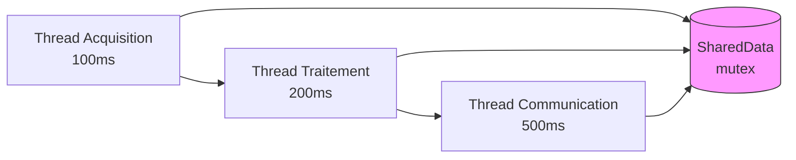
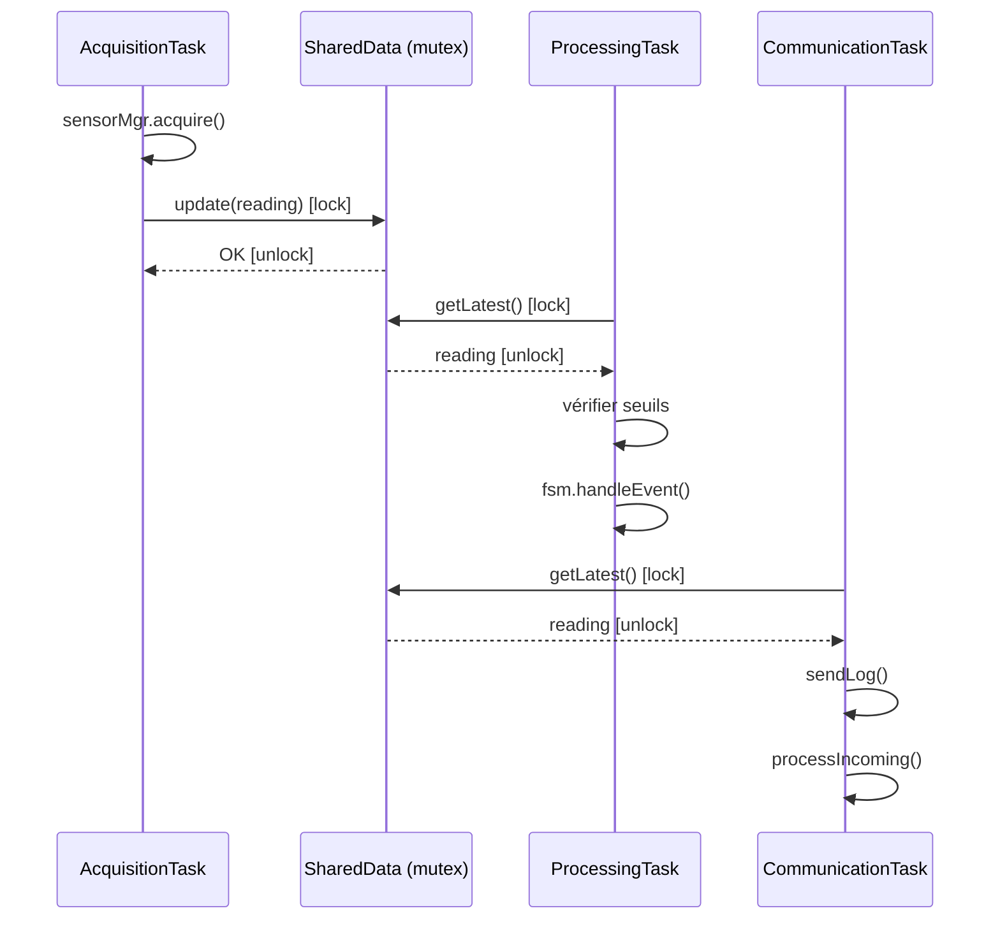

# Phase 5 - Multithreading (PC) (Documentation détaillée)

**Statut** : ✅ Validée
**Date** : 10 Novembre 2026
**Tests** : 50/50 passés

---

## 📋 Table des matières

1. [Objectif](#objectif)
2. [Architecture](#architecture)
3. [Notions clés](#notions-clés)
4. [SharedData — Données partagées thread-safe](#shareddata--données-partagées-thread-safe)
5. [AcquisitionTask — Tâche d'acquisition](#acquisitiontask--tâche-dacquisition)
6. [ProcessingTask — Tâche de traitement](#processingtask--tâche-de-traitement)
7. [CommunicationTask — Tâche de communication](#communicationtask--tâche-de-communication)
8. [Fichiers créés](#fichiers-créés)
9. [Tests unitaires](#tests-unitaires)
10. [Résultats des tests](#résultats-des-tests)
11. [Ce qu'on a appris](#ce-quon-a-appris)
12. [Prochaines étapes](#prochaines-étapes)

---

## Objectif

Lancer **l'acquisition, le traitement et la communication en parallèle** avec `std::thread`, comme dans un vrai système embarqué multitâche. Les données sont partagées entre les threads de manière **thread-safe** grâce à un mutex.

### Pourquoi le multithreading ?

| Sans threads | Avec threads |
|-------------|-------------|
| Acquisition → Traitement → Communication (séquentiel) | Acquisition ‖ Traitement ‖ Communication (parallèle) |
| Le traitement attend l'acquisition | Chaque tâche tourne à son propre rythme |
| Communication bloquante | Communication non bloquante |
| Temps de cycle = somme des durées | Temps de cycle = durée la plus longue |

---

## Architecture



### Flux de données entre threads



---

## Notions clés

### 1. Thread (fil d'exécution)

Un **thread** est un fil d'exécution indépendant. Plusieurs threads tournent en "parallèle" grâce à l'alternance rapide du CPU (time-slicing).

```cpp
std::thread worker(&MyClass::run, this);  // Crée un thread qui appelle run()
worker.join();  // Attend la fin du thread
```

**Cycle de vie d'un thread :**
1. **Création** : `std::thread t(func)`
2. **Exécution** : le thread tourne en parallèle
3. **Arrêt** : signaler l'arrêt (flag atomique)
4. **Join** : attendre la fin propre du thread

### 2. Mutex (verrou)

Un **mutex** empêche deux threads d'accéder à la même donnée en même temps :

```cpp
std::mutex mtx;
std::lock_guard<std::mutex> lock(mtx);  // Verrouille automatiquement
// ... accès aux données protégées ...
// Le mutex est déverrouillé à la destruction de lock (RAII)
```

**RAII (Resource Acquisition Is Initialization)** : Le mutex est automatiquement déverrouillé quand le `lock_guard` sort de portée, même en cas d'exception.

### 3. Variable atomique (std::atomic)

Une variable atomique peut être lue/écrite par plusieurs threads sans mutex :

```cpp
std::atomic<bool> running{false};
running.store(true);   // Écriture atomique
running.load();        // Lecture atomique
```

**Usage :** Flag d'arrêt pour les threads (pas besoin de mutex pour un simple booléen).

### 4. Condition de course (Race Condition)

Une **race condition** se produit quand deux threads accèdent à la même donnée simultanément, dont au moins un en écriture, sans synchronisation.

**Exemple de corruption :**
```
Thread A écrit x = 5
Thread B lit x → peut lire 0, 5, ou une valeur corrompue
```

**Solution :** Mutex ou variable atomique.

---

## SharedData — Données partagées thread-safe

### Fichier : `app/processing/SharedData.hpp`

```cpp
#pragma once
#include <mutex>
#include <cstdint>
#include <atomic>

struct SensorReading {
    double temperature;
    double humidity;
    double pressure;
    uint64_t timestamp;
};

class SharedData {
private:
    mutable std::mutex mtx;
    SensorReading latest;
    bool dataReady = false;
    std::atomic<uint64_t> updateCount{0};

public:
    void update(const SensorReading& data);
    SensorReading getLatest() const;
    bool isReady() const;
    uint64_t getUpdateCount() const;
};
```

### Fichier : `app/processing/SharedData.cpp`

#### Méthode `update(const SensorReading& data)`

```cpp
void SharedData::update(const SensorReading& data) {
    std::lock_guard<std::mutex> lock(mtx);
    latest = data;
    dataReady = true;
    ++updateCount;
}
```

**Logique :**
1. Verrouiller le mutex (RAII)
2. Copier les données dans `latest`
3. Marquer `dataReady = true`
4. Incrémenter le compteur (atomique, mais protégé par le mutex)
5. Déverrouiller automatiquement à la sortie

#### Méthode `getLatest() const`

```cpp
SensorReading SharedData::getLatest() const {
    std::lock_guard<std::mutex> lock(mtx);
    return latest;
}
```

**Note :** `mutable std::mutex mtx` permet de verrouiller dans une méthode `const`.

#### Méthode `isReady() const`

```cpp
bool SharedData::isReady() const {
    std::lock_guard<std::mutex> lock(mtx);
    return dataReady;
}
```

#### Méthode `getUpdateCount() const`

```cpp
uint64_t SharedData::getUpdateCount() const {
    return updateCount.load();
}
```

**Note :** Pas de mutex ici car `updateCount` est `std::atomic`. La lecture atomique est suffisante.

---

## AcquisitionTask — Tâche d'acquisition

### Fichier : `app/acquisition/AcquisitionTask.hpp`

```cpp
#pragma once
#include "SensorManager.hpp"
#include "app/processing/SharedData.hpp"
#include "app/control/StateMachine.hpp"
#include <atomic>
#include <thread>
#include <chrono>

class AcquisitionTask {
private:
    SensorManager& sensorMgr;
    SharedData& shared;
    std::atomic<bool> running{false};
    std::thread worker;
    int intervalMs;

    void run();

public:
    AcquisitionTask(SensorManager& mgr, SharedData& data, int intervalMs = 100);
    ~AcquisitionTask();
    void start();
    void stop();
    bool isRunning() const;
};
```

### Fichier : `app/acquisition/AcquisitionTask.cpp`

#### Constructeur et destructeur

```cpp
AcquisitionTask::AcquisitionTask(SensorManager& mgr, SharedData& data, int intervalMs)
    : sensorMgr(mgr),
      shared(data),
      intervalMs(intervalMs)
{
}

AcquisitionTask::~AcquisitionTask() {
    stop();  // S'assure que le thread est arrêté
}
```

**Le destructeur appelle `stop()`** pour éviter qu'un thread tourne après la destruction de l'objet (comportement indéfini).

#### Méthode `run()` (privée)

```cpp
void AcquisitionTask::run() {
    while (running.load()) {
        sensorMgr.acquire();

        SensorReading reading;
        reading.temperature = sensorMgr.getTemperatureAvg();
        reading.humidity = sensorMgr.getHumidityAvg();
        reading.pressure = sensorMgr.getPressureAvg();
        reading.timestamp = static_cast<uint64_t>(
            std::chrono::duration_cast<std::chrono::milliseconds>(
                std::chrono::system_clock::now().time_since_epoch()).count());

        shared.update(reading);

        std::this_thread::sleep_for(std::chrono::milliseconds(intervalMs));
    }
}
```

**Logique :**
1. Acquérir les données de tous les capteurs
2. Construire un `SensorReading` avec les moyennes
3. Mettre à jour `SharedData` (thread-safe)
4. Attendre `intervalMs` millisecondes
5. Répéter tant que `running == true`

#### Méthodes `start()` et `stop()`

```cpp
void AcquisitionTask::start() {
    if (!running.load()) {
        running.store(true);
        worker = std::thread(&AcquisitionTask::run, this);
    }
}

void AcquisitionTask::stop() {
    if (running.load()) {
        running.store(false);
        if (worker.joinable()) {
            worker.join();
        }
    }
}
```

**`joinable()`** : Vérifie si le thread peut être joint (a été démarré et pas encore joint).

**`join()`** : Attend la fin de l'exécution du thread. Bloque jusqu'à ce que `run()` se termine.

---

## ProcessingTask — Tâche de traitement

### Fichier : `app/processing/ProcessingTask.hpp/.cpp`

```cpp
class ProcessingTask {
private:
    SharedData& shared;
    StateMachine& fsm;
    std::atomic<bool> running{false};
    std::thread worker;
    int intervalMs;

    void run();

public:
    ProcessingTask(SharedData& data, StateMachine& fsm, int intervalMs = 200);
    ~ProcessingTask();
    void start();
    void stop();
    bool isRunning() const;
};
```

#### Méthode `run()`

```cpp
void ProcessingTask::run() {
    while (running.load()) {
        if (shared.isReady()) {
            SensorReading reading = shared.getLatest();

            // Vérifier les seuils
            if (reading.temperature > 30.0 || reading.temperature < 10.0) {
                fsm.handleEvent(Event::THRESHOLD_EXCEEDED);
            }
        }

        std::this_thread::sleep_for(std::chrono::milliseconds(intervalMs));
    }
}
```

**Logique :**
1. Vérifier si des données sont disponibles
2. Lire les données partagées
3. Vérifier les seuils de température
4. Si seuil dépassé → notifier la FSM
5. Attendre `intervalMs` millisecondes

---

## CommunicationTask — Tâche de communication

### Fichier : `app/communication/CommunicationTask.hpp/.cpp`

```cpp
class CommunicationTask {
private:
    CommunicationManager& comm;
    SharedData& shared;
    Logger& logger;
    std::atomic<bool> running{false};
    std::thread worker;
    int intervalMs;

    void run();

public:
    CommunicationTask(CommunicationManager& cm, SharedData& data, Logger& log, int intervalMs = 500);
    ~CommunicationTask();
    void start();
    void stop();
    bool isRunning() const;
};
```

#### Méthode `run()`

```cpp
void CommunicationTask::run() {
    while (running.load()) {
        if (shared.isReady()) {
            SensorReading reading = shared.getLatest();
            std::string msg = "Temp=" + std::to_string(reading.temperature) +
                              " Hum=" + std::to_string(reading.humidity) +
                              " Pres=" + std::to_string(reading.pressure);
            comm.sendLog(LogLevel::INFO, msg);
        }

        comm.processIncoming();

        std::this_thread::sleep_for(std::chrono::milliseconds(intervalMs));
    }
}
```

**Logique :**
1. Vérifier si des données sont disponibles
2. Lire les données partagées
3. Formater et envoyer via le CommunicationManager
4. Traiter les commandes entrantes
5. Attendre `intervalMs` millisecondes

---

## Fichiers créés

### Structure des dossiers

```
app/
├── processing/
│   ├── SharedData.hpp/.cpp       ← Données partagées thread-safe
│   ├── ProcessingTask.hpp/.cpp   ← Tâche de traitement
│   └── (Phase 2 files...)
├── acquisition/
│   ├── AcquisitionTask.hpp/.cpp  ← Tâche d'acquisition
│   └── (Phase 2 files...)
└── communication/
    ├── CommunicationTask.hpp/.cpp ← Tâche de communication
    └── (Phase 4 files...)
tests/
└── test_threading.cpp            ← 8 tests
```

### Détail des fichiers

| Fichier | Lignes | Rôle |
|---------|--------|------|
| `SharedData.hpp/.cpp` | ~30 | Données partagées avec mutex |
| `AcquisitionTask.hpp/.cpp` | ~50 | Tâche d'acquisition (100ms) |
| `ProcessingTask.hpp/.cpp` | ~40 | Tâche de traitement (200ms) |
| `CommunicationTask.hpp/.cpp` | ~45 | Tâche de communication (500ms) |
| `test_threading.cpp` | ~120 | 8 tests |

---

## Tests unitaires

### Fichier : `tests/test_threading.cpp`

8 tests répartis en 3 suites :

#### Suite SharedData (4 tests)

| Test | Vérification |
|------|-------------|
| `UpdateAndGet` | update() puis getLatest() retourne les bonnes valeurs |
| `UpdateCount` | Le compteur s'incrémente correctement |
| `ThreadSafety` | 10 threads écrivent + 10 threads lisent sans crash |
| `NoRaceCondition` | Pas de données corrompues après 1000 itérations |

#### Suite AcquisitionTask (2 tests)

| Test | Vérification |
|------|-------------|
| `StartStop` | Le thread démarre et s'arrête proprement |
| `DataAcquired` | Les données sont acquises et dans la bonne plage |

#### Suite ProcessingTask (1 test)

| Test | Vérification |
|------|-------------|
| `StartStop` | Le thread démarre et s'arrête proprement |

#### Suite CommunicationTask (1 test)

| Test | Vérification |
|------|-------------|
| `StartStop` | Le thread démarre et s'arrête proprement |

### Exemple de test : `ThreadSafety`

```cpp
TEST(SharedDataTest, ThreadSafety) {
    SharedData shared;
    std::atomic<int> errors{0};

    // 10 threads qui écrivent
    std::vector<std::thread> writers;
    for (int i = 0; i < 10; ++i) {
        writers.emplace_back([&shared, &errors, i]() {
            for (int j = 0; j < 100; ++j) {
                try {
                    shared.update({static_cast<double>(i), static_cast<double>(j), 1000.0, static_cast<uint64_t>(j)});
                } catch (...) {
                    ++errors;
                }
            }
        });
    }

    // 10 threads qui lisent
    std::vector<std::thread> readers;
    for (int i = 0; i < 10; ++i) {
        readers.emplace_back([&shared, &errors]() {
            for (int j = 0; j < 100; ++j) {
                try {
                    SensorReading r = shared.getLatest();
                    (void)r;
                } catch (...) {
                    ++errors;
                }
            }
        });
    }

    for (auto& t : writers) t.join();
    for (auto& t : readers) t.join();

    EXPECT_EQ(errors.load(), 0);
}
```

**Ce test vérifie :**
- 10 threads écrivent simultanément (1000 écritures chacun)
- 10 threads lisent simultanément (1000 lectures chacun)
- Aucune exception n'est levée
- Le mutex protège correctement les données

---

## Résultats des tests

```
[==========] Running 50 tests from 11 test suites.
[  PASSED  ] 50 tests.
```

**Temps total : ~14 secondes** (les tests de threading avec `sleep_for` prennent du temps)

---

## Ce qu'on a appris

### Compétences acquises

1. **std::thread** : Création et gestion de threads
2. **std::mutex** : Protection des données partagées
3. **std::lock_guard** : RAII pour le verrouillage automatique
4. **std::atomic** : Variables atomiques pour les flags
5. **std::chrono** : Gestion du temps (sleep_for, duration_cast)
6. **Cycle de vie des threads** : start, stop, join, joinable
7. **Destructeur** : Arrêt automatique des threads à la destruction
8. **Race condition** : Comprendre et éviter les accès concurrents
9. **Thread-safety** : Protéger les données partagées

### Patterns de design utilisés

| Pattern | Description |
|---------|-------------|
| **RAII** | `lock_guard` déverrouille automatiquement |
| **Task** | Chaque tâche est une classe avec start/stop |
| **Shared State** | `SharedData` est le point de partage entre threads |

### Points d'attention pour l'embarqué

- **Pas de `std::thread` en embarqué réel** : on utilise FreeRTOS (xTaskCreate)
- **Le mutex** devient un `xSemaphore` FreeRTOS
- **Le `sleep_for`** devient `vTaskDelay()`
- **La priorité** des tâches doit être définie (FreeRTOS)
- **La stack size** doit être configurée pour chaque tâche
- **Les interruptions** doivent être gérées (désactivées pendant les sections critiques)

---

## Prochaines étapes

La **Phase 6** consistera à :
1. Créer une couche d'abstraction (ITask, IMutex, ITimer)
2. Implémenter la couche Host (PC) avec std::thread
3. Créer FreeRTOSCompat (stubs pour l'API FreeRTOS)
4. Adapter les tâches de la Phase 5 pour utiliser les interfaces
5. Préparer le portage vers FreeRTOS réel

---

## Commandes de référence

```bash
# Compiler
cmake --build build

# Lancer les tests
cd build && ./embeddedsense_tests.exe

# Ou en une commande depuis la racine
cmake --build build && build/embeddedsense_tests.exe
```

---

