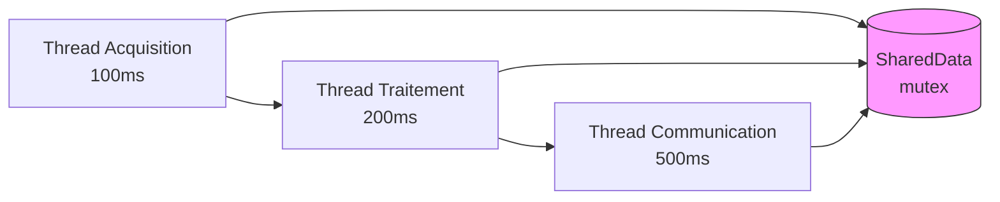

# Phase 5 - Multithreading (PC)

**Objectif** : Lancer l'acquisition, le traitement et la communication en parallèle avec `std::thread`, comme dans un vrai système embarqué multitâche.

---

## 🧠 Notions clés

- **Thread** : Un fil d'exécution indépendant. Plusieurs threads tournent en "parallèle" grâce à l'alternance rapide du CPU.
- **Mutex** : Un verrou qui empêche deux threads d'accéder à la même donnée en même temps.
- **Condition variable** : Permet à un thread d'attendre qu'un événement se produise.

---

## Architecture



---

## 🛠️ Étapes à réaliser

### 1. Créer `SharedData`

Créer `app/processing/SharedData.hpp` et `.cpp` :

```cpp
#pragma once
#include <mutex>
#include <cstdint>

struct SensorReading {
    double temperature;
    double humidity;
    double pressure;
    uint64_t timestamp;
};

class SharedData {
private:
    mutable std::mutex mtx;
    SensorReading latest;
    bool dataReady = false;
public:
    void update(const SensorReading& data);
    SensorReading getLatest() const;
    bool isReady() const;
};
```

### 2. Créer `AcquisitionTask`

Créer `app/acquisition/AcquisitionTask.hpp` et `.cpp` :

```cpp
#pragma once
#include "SensorManager.hpp"
#include "app/processing/SharedData.hpp"
#include <atomic>
#include <thread>

class AcquisitionTask {
private:
    SensorManager& sensorMgr;
    SharedData& shared;
    std::atomic<bool> running{false};
    std::thread worker;
public:
    AcquisitionTask(SensorManager& mgr, SharedData& data);
    void start();
    void stop();
};
```

### 3. Créer `ProcessingTask`

Créer `app/processing/ProcessingTask.hpp` et `.cpp` :

```cpp
#pragma once
#include "SharedData.hpp"
#include "app/control/StateMachine.hpp"
#include <atomic>
#include <thread>

class ProcessingTask {
private:
    SharedData& shared;
    StateMachine& fsm;
    std::atomic<bool> running{false};
    std::thread worker;
public:
    ProcessingTask(SharedData& data, StateMachine& fsm);
    void start();
    void stop();
};
```

### 4. Créer `CommunicationTask`

Créer `app/communication/CommunicationTask.hpp` et `.cpp` :

```cpp
#pragma once
#include "CommunicationManager.hpp"
#include "app/processing/SharedData.hpp"
#include "services/logger/Logger.hpp"
#include <atomic>
#include <thread>

class CommunicationTask {
private:
    CommunicationManager& comm;
    SharedData& shared;
    Logger& logger;
    std::atomic<bool> running{false};
    std::thread worker;
public:
    CommunicationTask(CommunicationManager& cm, SharedData& data, Logger& log);
    void start();
    void stop();
};
```

### 5. Écrire les tests

| Test | Vérification |
|------|-------------|
| `SharedData.threadSafety` | 10 threads écrivent + 10 lisent sans crash |
| `SharedData.update/get` | La dernière valeur écrite est toujours lisible |
| `AcquisitionTask.start/stop` | Le thread démarre et s'arrête proprement |
| `NoRaceCondition` | Pas de données corrompues après 1000 itérations |

### 6. Mettre à jour CMakeLists.txt

Lier avec `-lpthread` (MSYS2) pour `std::thread`.

---

## ✅ Checklist de validation

- [ ] `SharedData` est thread-safe (mutex présent)
- [ ] 3 threads tournent simultanément sans crash
- [ ] `stop()` arrête proprement tous les threads
- [ ] Pas de fuite mémoire
- [ ] 4+ tests unitaires passent
- [ ] `cmake --build build && cd build && ctest` : tous les tests passent

---

## 📁 Fichiers à créer/modifier

| Fichier | Action |
|---------|--------|
| `app/processing/SharedData.hpp` | Créer |
| `app/processing/SharedData.cpp` | Créer |
| `app/acquisition/AcquisitionTask.hpp` | Créer |
| `app/acquisition/AcquisitionTask.cpp` | Créer |
| `app/processing/ProcessingTask.hpp` | Créer |
| `app/processing/ProcessingTask.cpp` | Créer |
| `app/communication/CommunicationTask.hpp` | Créer |
| `app/communication/CommunicationTask.cpp` | Créer |
| `tests/test_threading.cpp` | Créer |
| `CMakeLists.txt` | Modifier |
