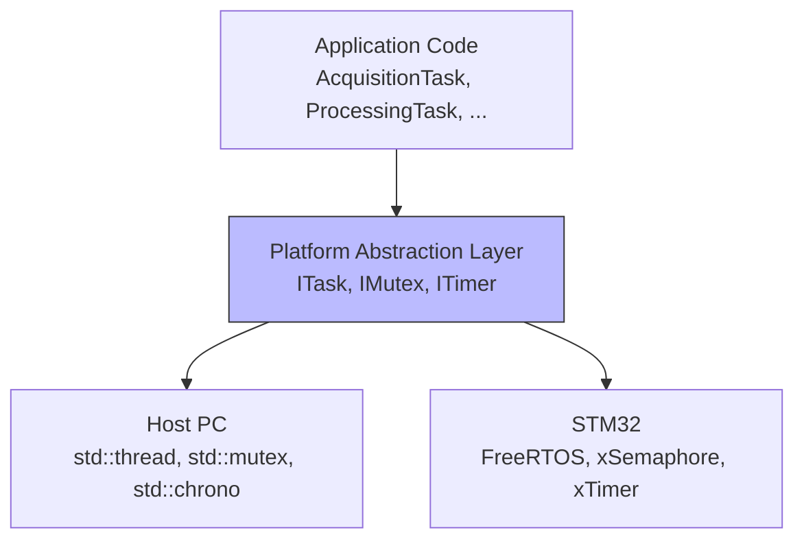

# Phase 6 - FreeRTOS simulé (Documentation détaillée)

**Statut** : ✅ Validée
**Date** : 10 Novembre 2026
**Tests** : 60/60 passés

---

## 📋 Table des matières

1. [Objectif](#objectif)
2. [Architecture](#architecture)
3. [Notions clés](#notions-clés)
4. [Interfaces d'abstraction (ITask, IMutex, ITimer)](#interfaces-dabstraction)
5. [Implémentation Host (PC)](#implémentation-host-pc)
6. [FreeRTOSCompat — Stubs pour STM32](#freertoscompat--stubs-pour-stm32)
7. [Fichiers créés](#fichiers-créés)
8. [Tests unitaires](#tests-unitaires)
9. [Résultats des tests](#résultats-des-tests)
10. [Ce qu'on a appris](#ce-quon-a-appris)
11. [Prochaines étapes](#prochaines-étapes)

---

## Objectif

Remplacer `std::thread` par une **couche d'abstraction** compatible FreeRTOS. Le code applicatif utilise des interfaces (`ITask`, `IMutex`, `ITimer`) au lieu d'appeler directement `std::thread` ou `std::mutex`. Sur PC, ces interfaces sont implémentées avec `std::thread`. Sur STM32, elles seront implémentées avec FreeRTOS.

### Pourquoi une couche d'abstraction ?

| Sans abstraction | Avec abstraction |
|-----------------|-----------------|
| Code dépend de `std::thread` | Code dépend de `ITask` |
| Impossible de porter sur STM32 sans tout réécrire | Changement d'implémentation = changer la couche basse |
| Tests liés à la plateforme | Tests portables |
| Couplage fort | Couplage faible (Dependency Inversion) |

---

## Architecture



### Principe : Dependency Inversion

Le code applicatif dépend des **interfaces** (ITask, IMutex, ITimer), pas des implémentations concrètes. C'est le principe **D** de SOLID (Dependency Inversion Principle).

```
Application → ITask (interface) ← HostTask (implémentation PC)
                              ← STM32Task (implémentation STM32)
```

---

## Notions clés

### 1. Abstraction layer (couche d'abstraction)

Une couche d'abstraction cache les détails d'implémentation derrière une interface. Le code applicatif utilise l'interface, et l'implémentation concrète peut changer sans modifier le code applicatif.

### 2. FreeRTOS

FreeRTOS est le système d'exploitation temps réel (RTOS) le plus utilisé dans l'embarqué :
- **Tâches** : `xTaskCreate()` au lieu de `std::thread`
- **Mutex** : `xSemaphoreCreateMutex()` au lieu de `std::mutex`
- **Timers** : `xTimerCreate()` au lieu de `std::chrono`
- **Délai** : `vTaskDelay()` au lieu de `std::this_thread::sleep_for()`

### 3. Préemptif vs Coopératif

| Coopératif | Préemptif (FreeRTOS) |
|-----------|---------------------|
| La tâche cède le CPU volontairement | Le RTOS interrompt la tâche |
| Simple mais dangereux (blocage) | Plus complexe mais sûr |
| `yield()` explicite | Interruption par le scheduler |

### 4. Stub (bouchon)

Un **stub** est une implémentation vide ou minimale qui permet au code de compiler et de tourner sur une plateforme différente. Sur PC, `vTaskDelay()` est un stub qui appelle `std::this_thread::sleep_for()`.

---

## Interfaces d'abstraction

### ITask — Interface de tâche

**Fichier :** `platform/abstraction/ITask.hpp`

```cpp
#pragma once

class ITask {
public:
    virtual ~ITask() = default;
    virtual void start() = 0;
    virtual void stop() = 0;
    virtual bool isRunning() const = 0;
};
```

| Méthode | Rôle |
|---------|------|
| `start()` | Démarre la tâche |
| `stop()` | Arrête la tâche |
| `isRunning()` | Vérifie si la tâche tourne |

### IMutex — Interface de mutex

**Fichier :** `platform/abstraction/IMutex.hpp`

```cpp
#pragma once

class IMutex {
public:
    virtual ~IMutex() = default;
    virtual void lock() = 0;
    virtual void unlock() = 0;
};
```

### ITimer — Interface de timer

**Fichier :** `platform/abstraction/ITimer.hpp`

```cpp
#pragma once
#include <cstdint>

class ITimer {
public:
    virtual ~ITimer() = default;
    virtual void start(uint32_t periodMs) = 0;
    virtual void stop() = 0;
    virtual bool hasExpired() const = 0;
};
```

---

## Implémentation Host (PC)

### HostTask — Tâche sur PC

**Fichier :** `platform/host/HostTask.hpp/.cpp`

```cpp
class HostTask : public ITask {
private:
    std::atomic<bool> running{false};
    std::thread worker;
    std::function<void()> taskFunc;

public:
    explicit HostTask(std::function<void()> func);
    ~HostTask();
    void start() override;
    void stop() override;
    bool isRunning() const override;
};
```

**Implémentation de `start()` :**

```cpp
void HostTask::start() {
    if (!running.load()) {
        running.store(true);
        worker = std::thread([this]() {
            while (running.load()) {
                if (taskFunc) {
                    taskFunc();
                }
            }
        });
    }
}
```

**Note :** Le lambda capture `this` et appelle `taskFunc()` en boucle. C'est différent de la Phase 5 où chaque tâche avait sa propre méthode `run()`. Ici, `HostTask` est générique et reçoit une fonction.

### HostMutex — Mutex sur PC

**Fichier :** `platform/host/HostMutex.hpp/.cpp`

```cpp
class HostMutex : public IMutex {
private:
    std::mutex mtx;

public:
    void lock() override { mtx.lock(); }
    void unlock() override { mtx.unlock(); }
};
```

**Simple délégation** vers `std::mutex`.

### HostTimer — Timer sur PC

**Fichier :** `platform/host/HostTimer.hpp/.cpp`

```cpp
class HostTimer : public ITimer {
private:
    std::chrono::steady_clock::time_point startTime;
    uint32_t periodMs = 0;
    mutable std::atomic<bool> running{false};
    mutable std::atomic<bool> expired{false};

public:
    void start(uint32_t periodMs) override;
    void stop() override;
    bool hasExpired() const override;
};
```

**Implémentation de `hasExpired()` :**

```cpp
bool HostTimer::hasExpired() const {
    if (!running.load()) return expired.load();
    auto now = std::chrono::steady_clock::now();
    auto elapsed = std::chrono::duration_cast<std::chrono::milliseconds>(now - startTime).count();
    if (elapsed >= static_cast<long long>(periodMs)) {
        expired.store(true);
        return true;
    }
    return false;
}
```

**Logique :**
1. Si le timer n'est pas lancé → retourner l'état expiré
2. Calculer le temps écoulé depuis le démarrage
3. Si le temps écoulé ≥ période → expiré

---

## FreeRTOSCompat — Stubs pour STM32

### Fichier : `platform/stm32/FreeRTOSCompat.hpp`

```cpp
#pragma once
#include <cstdint>
#include "platform/abstraction/IMutex.hpp"

void vTaskDelay(uint32_t ticks);
void xSemaphoreTake(IMutex& mtx);
void xSemaphoreGive(IMutex& mtx);
```

### Fichier : `platform/stm32/FreeRTOSCompat.cpp`

```cpp
#include "platform/stm32/FreeRTOSCompat.hpp"
#include "platform/abstraction/IMutex.hpp"
#include <thread>
#include <chrono>

void vTaskDelay(uint32_t ticks) {
    std::this_thread::sleep_for(std::chrono::milliseconds(ticks));
}

void xSemaphoreTake(IMutex& mtx) {
    mtx.lock();
}

void xSemaphoreGive(IMutex& mtx) {
    mtx.unlock();
}
```

**Ces fonctions ont les mêmes noms que l'API FreeRTOS.** Sur PC, elles sont des stubs. Sur STM32, elles seront remplacées par les vraies fonctions FreeRTOS.

| Fonction FreeRTOS | Stub PC | Vraie implémentation STM32 |
|-------------------|---------|---------------------------|
| `vTaskDelay(ticks)` | `std::this_thread::sleep_for()` | `vTaskDelay()` FreeRTOS |
| `xSemaphoreTake(mtx)` | `mtx.lock()` | `xSemaphoreTake()` FreeRTOS |
| `xSemaphoreGive(mtx)` | `mtx.unlock()` | `xSemaphoreGive()` FreeRTOS |

---

## Fichiers créés

### Structure des dossiers

```
platform/
├── abstraction/
│   ├── ITask.hpp              ← Interface de tâche
│   ├── IMutex.hpp             ← Interface de mutex
│   └── ITimer.hpp             ← Interface de timer
├── host/
│   ├── HostTask.hpp/.cpp      ← Implémentation PC (std::thread)
│   ├── HostMutex.hpp/.cpp      ← Implémentation PC (std::mutex)
│   └── HostTimer.hpp/.cpp     ← Implémentation PC (std::chrono)
└── stm32/
    ├── FreeRTOSCompat.hpp      ← Stubs FreeRTOS
    └── FreeRTOSCompat.cpp      ← Implémentation des stubs
tests/
└── test_freertos_compat.cpp   ← 11 tests
```

### Détail des fichiers

| Fichier | Lignes | Rôle |
|---------|--------|------|
| `ITask.hpp` | ~10 | Interface de tâche |
| `IMutex.hpp` | ~10 | Interface de mutex |
| `ITimer.hpp` | ~12 | Interface de timer |
| `HostTask.hpp/.cpp` | ~40 | Implémentation PC |
| `HostMutex.hpp/.cpp` | ~15 | Implémentation PC |
| `HostTimer.hpp/.cpp` | ~40 | Implémentation PC |
| `FreeRTOSCompat.hpp/.cpp` | ~20 | Stubs FreeRTOS |
| `test_freertos_compat.cpp` | ~120 | 11 tests |

---

## Tests unitaires

### Fichier : `tests/test_freertos_compat.cpp`

11 tests répartis en 4 suites :

#### Suite HostTask (2 tests)

| Test | Vérification |
|------|-------------|
| `StartStop` | Le thread démarre et s'arrête |
| `DestructorStops` | Le destructeur arrête le thread sans crash |

#### Suite HostMutex (2 tests)

| Test | Vérification |
|------|-------------|
| `LockUnlock` | lock/unlock sans crash |
| `ThreadSafety` | 10 threads × 100 incrémentations = 1000 (pas de race condition) |

#### Suite HostTimer (3 tests)

| Test | Vérification |
|------|-------------|
| `NotExpiredInitially` | Le timer n'est pas expiré immédiatement |
| `ExpiresAfterPeriod` | Le timer expire après la période |
| `StopResets` | stop() remet l'état expiré à false |

#### Suite FreeRTOSCompat (3 tests)

| Test | Vérification |
|------|-------------|
| `VTaskDelay` | vTaskDelay(50) attend au moins 40ms |
| `XSemaphoreTakeGive` | xSemaphoreTake/Give sans crash |
| `CompileCheck` | Les fonctions FreeRTOSCompat compilent |

### Exemple de test : `ThreadSafety`

```cpp
TEST(HostMutexTest, ThreadSafety) {
    HostMutex mtx;
    std::atomic<int> counter{0};
    std::vector<std::thread> threads;

    for (int i = 0; i < 10; ++i) {
        threads.emplace_back([&mtx, &counter]() {
            for (int j = 0; j < 100; ++j) {
                mtx.lock();
                ++counter;
                mtx.unlock();
            }
        });
    }

    for (auto& t : threads) t.join();
    EXPECT_EQ(counter.load(), 1000);
}
```

**Ce test vérifie :**
- 10 threads incrémentent un compteur 100 fois chacun
- Le mutex protège l'incrémentation
- Résultat attendu : 1000 (pas de perte due à une race condition)

---

## Résultats des tests

```
[==========] Running 60 tests from 15 test suites.
[  PASSED  ] 60 tests.
```

---

## Ce qu'on a appris

### Compétences acquises

1. **Couche d'abstraction** : Séparer l'interface de l'implémentation
2. **Dependency Inversion** : Le code dépend des interfaces, pas des implémentations
3. **FreeRTOS API** : vTaskDelay, xSemaphoreTake/Give, xTaskCreate
4. **Stubs** : Implémentations minimales pour la compilation sur PC
5. **std::function** : Stocker une fonction comme membre de classe
6. **mutable atomic** : Permettre la modification dans une méthode const
7. **Portabilité** : Code qui fonctionne sur PC et STM32

### Patterns de design utilisés

| Pattern | Description |
|---------|-------------|
| **Abstraction Layer** | Interfaces ITask, IMutex, ITimer |
| **Strategy** | HostTask vs STM32Task sont des stratégies interchangeables |
| **Stub** | FreeRTOSCompat fournit des stubs pour PC |
| **Dependency Inversion** | Le code dépend des interfaces |

### Points d'attention pour l'embarqué

- **Sur STM32**, `HostTask` sera remplacé par `STM32Task` qui utilise `xTaskCreate`
- **Le mutex** deviendra un `xSemaphore` FreeRTOS
- **Le timer** deviendra un `xTimer` FreeRTOS
- **Les priorités** des tâches doivent être définies (FreeRTOS)
- **La stack size** doit être configurée pour chaque tâche
- **L'API FreeRTOS** a les mêmes noms que nos stubs → transition transparente

---

## Prochaines étapes

La **Phase 7** consistera à :
1. Écrire des tests d'intégration (scénarios bout-en-bout)
2. Tester l'interaction entre toutes les couches
3. Tests de robustesse (stress, concurrent access, invalid sensors)
4. Valider que le système complet fonctionne sans bugs

---

## Commandes de référence

```bash
# Compiler
cmake --build build

# Lancer les tests
cd build && ./embeddedsense_tests.exe

# Ou en une commande depuis la racine
cmake --build build && build/embeddedsense_tests.exe
```

---

