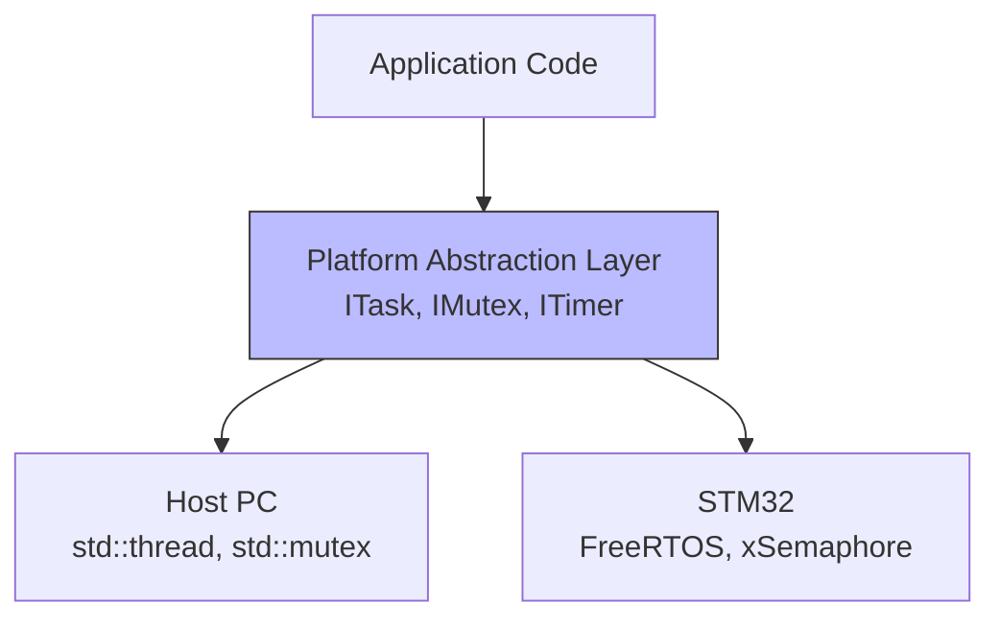

# Phase 6 - FreeRTOS simulé

**Objectif** : Remplacer `std::thread` par une couche d'abstraction compatible FreeRTOS. Préparer le portage vers du vrai FreeRTOS sur STM32.

---

## 🧠 Notions clés

- **FreeRTOS** : Le système d'exploitation temps réel (RTOS) le plus utilisé dans l'embarqué. Gère les tâches, mutex, timers, files de messages.
- **Abstraction layer** : Couche intermédiaire qui cache les détails d'implémentation. Sur PC → std::thread ; sur STM32 → FreeRTOS.
- **Préemptif** : FreeRTOS interrompt une tâche pour en lancer une autre selon les priorités.

---

## Architecture d'abstraction



---

## 🛠️ Étapes à réaliser

### 1. Créer les interfaces abstraites

Créer `platform/abstraction/ITask.hpp` :

```cpp
#pragma once

class ITask {
public:
    virtual ~ITask() = default;
    virtual void start() = 0;
    virtual void stop() = 0;
    virtual bool isRunning() const = 0;
};
```

Créer `platform/abstraction/IMutex.hpp` :

```cpp
#pragma once

class IMutex {
public:
    virtual ~IMutex() = default;
    virtual void lock() = 0;
    virtual void unlock() = 0;
};
```

Créer `platform/abstraction/ITimer.hpp` :

```cpp
#pragma once
#include <cstdint>

class ITimer {
public:
    virtual ~ITimer() = default;
    virtual void start(uint32_t periodMs) = 0;
    virtual void stop() = 0;
    virtual bool hasExpired() const = 0;
};
```

### 2. Implémenter la couche Host (PC)

| Fichier | Contenu |
|---------|---------|
| `platform/host/HostTask.hpp/.cpp` | `ITask` avec `std::thread` |
| `platform/host/HostMutex.hpp/.cpp` | `IMutex` avec `std::mutex` |
| `platform/host/HostTimer.hpp/.cpp` | `ITimer` avec `std::chrono` |

### 3. Créer `FreeRTOSCompat` (stub pour PC)

Créer `platform/stm32/FreeRTOSCompat.hpp` :

```cpp
#pragma once
#include <cstdint>

void vTaskDelay(uint32_t ticks);
```

### 4. Adapter les tâches de la Phase 5

Remplacer les `std::thread` dans AcquisitionTask, ProcessingTask, CommunicationTask par `ITask`.

### 5. Écrire les tests

| Test | Vérification |
|------|-------------|
| `HostTask.start/stop` | Le thread démarre et s'arrête |
| `HostMutex.lock/unlock` | Pas de race condition |
| `HostTimer` | Expiré après le délai spécifié |
| `TaskAbstraction` | Le même code fonctionne avec HostTask |
| `CompatAPI` | Les fonctions FreeRTOSCompat compilent |

### 6. Mettre à jour CMakeLists.txt

```cmake
option(PLATFORM_HOST "Build for PC (default)" ON)
```

---

## ✅ Checklist de validation

- [ ] Interfaces ITask, IMutex, ITimer créées
- [ ] Host implémentation fonctionne avec std::thread
- [ ] FreeRTOSCompat compile sur PC
- [ ] Les tâches de la Phase 5 utilisent les interfaces
- [ ] 5+ tests unitaires passent
- [ ] `cmake --build build && cd build && ctest` : tous les tests passent

---

## 📁 Fichiers à créer/modifier

| Fichier | Action |
|---------|--------|
| `platform/abstraction/ITask.hpp` | Créer |
| `platform/abstraction/IMutex.hpp` | Créer |
| `platform/abstraction/ITimer.hpp` | Créer |
| `platform/host/HostTask.hpp/.cpp` | Créer |
| `platform/host/HostMutex.hpp/.cpp` | Créer |
| `platform/host/HostTimer.hpp/.cpp` | Créer |
| `platform/stm32/FreeRTOSCompat.hpp` | Créer |
| `tests/test_freertos_compat.cpp` | Créer |
| `CMakeLists.txt` | Modifier |
