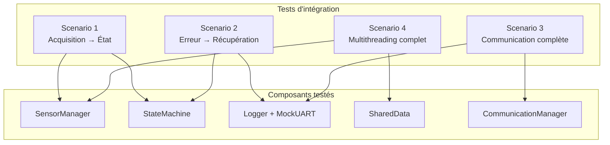
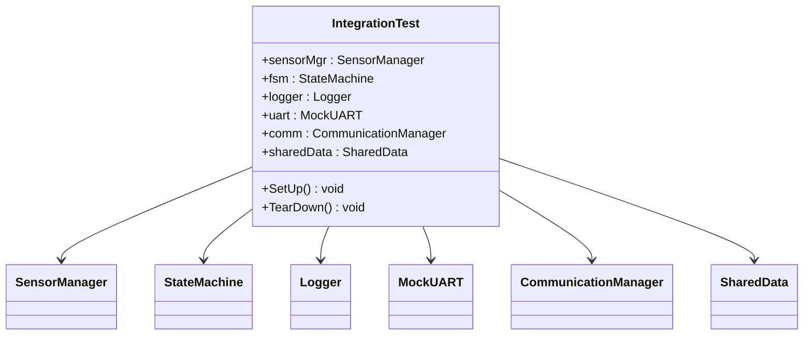

# Phase 7 - Tests d'intégration (Documentation détaillée)

**Statut** : ✅ Validée
**Date** : 10 Novembre 2026
**Tests** : 72/72 passés

---

## 📋 Table des matières

1. [Objectif](#objectif)
2. [Architecture](#architecture)
3. [Notions clés](#notions-clés)
4. [Scénarios d'intégration](#scénarios-dintégration)
5. [Tests de robustesse](#tests-de-robustesse)
6. [Fichiers créés](#fichiers-créés)
7. [Résultats des tests](#résultats-des-tests)
8. [Ce qu'on a appris](#ce-quon-a-appris)
9. [Prochaines étapes](#prochaines-étapes)

---

## Objectif

Valider que **toutes les couches** (capteurs, acquisition, états, logs, communication, multithreading) fonctionnent **ensemble** sans bugs. Les tests unitaires (Phases 1-6) testent chaque composant isolément. Les tests d'intégration testent les **interactions** entre composants.

### Test unitaire vs Test d'intégration

| Test unitaire | Test d'intégration |
|---------------|-------------------|
| Teste une seule classe | Teste plusieurs classes ensemble |
| Isole le composant (mocks) | Utilise les vrais composants |
| Rapide (< 1ms) | Plus lent (peut inclure des threads) |
| Vérifie la logique interne | Vérifie le flux de données |

---

## Architecture



### Fixture d'intégration



---

## Notions clés

### 1. Test d'intégration (Integration Test)

Un test d'intégration vérifie que **plusieurs composants** fonctionnent correctement **ensemble**. Contrairement au test unitaire qui isole un composant, le test d'intégration utilise les **vrais composants** et vérifie le **flux de données** entre eux.

### 2. Fixture (GoogleTest)

Une **fixture** est une classe qui hérite de `::testing::Test` et fournit un environnement de test réutilisable :

```cpp
class IntegrationTest : public ::testing::Test {
protected:
    SensorManager sensorMgr;
    StateMachine fsm;
    // ...

    void SetUp() override {
        // Initialisation avant chaque test
        sensorMgr.addSensor(std::make_unique<MockTemperatureSensor>(25.0));
    }

    void TearDown() override {
        // Nettoyage après chaque test
    }
};
```

**Avantages :**
- Code d'initialisation partagé entre les tests
- Isolation : chaque test a son propre environnement
- Lisibilité : les tests se concentrent sur le scénario

### 3. Test bout-en-bout (E2E)

Un test E2E simule le **scénario complet** de l'utilisateur, de bout en bout. Par exemple : acquisition → traitement → alerte → communication.

### 4. Robustesse (Robustness)

Les tests de robustesse vérifient que le système **ne crash pas** dans des conditions extrêmes :
- Stress test : beaucoup d'itérations
- Accès concurrent : plusieurs threads simultanés
- Données invalides : NaN, valeurs aberrantes

---

## Scénarios d'intégration

### Scénario 1 : Acquisition → État

**Fichier :** `test_integration.cpp` → `Scenario1_AcquisitionToState`

```cpp
TEST_F(IntegrationTest, Scenario1_AcquisitionToState) {
    fsm.handleEvent(Event::START);
    EXPECT_EQ(fsm.getCurrentState(), State::SURVEILLANCE);

    for (int i = 0; i < 50; ++i) {
        sensorMgr.acquire();
    }

    EXPECT_EQ(fsm.getCurrentState(), State::SURVEILLANCE);
}
```

**Ce que ça vérifie :**
1. Le système démarre en SURVEILLANCE
2. 50 acquisitions successives ne changent pas l'état
3. Les données sont acquises correctement

### Scénario 2 : Erreur → Récupération

**Fichier :** `test_integration.cpp` → `Scenario2_ErrorRecovery`

```cpp
TEST_F(IntegrationTest, Scenario2_ErrorRecovery) {
    fsm.handleEvent(Event::START);
    EXPECT_EQ(fsm.getCurrentState(), State::SURVEILLANCE);

    fsm.handleEvent(Event::ERROR);
    EXPECT_EQ(fsm.getCurrentState(), State::ERREUR);

    logger.log(LogLevel::ERROR, "Sensor failure detected");
    EXPECT_GE(logger.getLogCount(), 1u);

    fsm.handleEvent(Event::RESET);
    EXPECT_EQ(fsm.getCurrentState(), State::DORMANT);
}
```

**Ce que ça vérifie :**
1. Démarrage en SURVEILLANCE
2. Erreur → passage en ERREUR
3. Le logger enregistre l'erreur
4. RESET → retour en DORMANT

### Scénario 3 : Communication complète

**Fichier :** `test_integration.cpp` → `Scenario3_CommunicationFullFlow`

```cpp
TEST_F(IntegrationTest, Scenario3_CommunicationFullFlow) {
    sensorMgr.acquire();
    sensorMgr.acquire();

    comm.sendLog(LogLevel::INFO, "Temperature OK");
    EXPECT_EQ(logger.getLogCount(), 1u);
    EXPECT_EQ(uart.txAvailable(), 1u);
}
```

**Ce que ça vérifie :**
1. Acquisition de données
2. Envoi via CommunicationManager
3. Le Logger enregistre le message
4. L'UART transmet le message

### Scénario 4 : Flux complet (Acquire → Process → Log)

**Fichier :** `test_integration.cpp` → `FullFlow_AcquireProcessLog`

```cpp
TEST_F(IntegrationTest, FullFlow_AcquireProcessLog) {
    fsm.handleEvent(Event::START);

    for (int i = 0; i < 10; ++i) {
        sensorMgr.acquire();
        double tempAvg = sensorMgr.getTemperatureAvg();
        if (tempAvg > 30.0 || tempAvg < 10.0) {
            fsm.handleEvent(Event::THRESHOLD_EXCEEDED);
        }
        std::string msg = "Temp=" + std::to_string(tempAvg);
        comm.sendLog(LogLevel::INFO, msg);
    }

    EXPECT_GE(logger.getLogCount(), 10u);
    EXPECT_EQ(fsm.getCurrentState(), State::SURVEILLANCE);
}
```

**Ce que ça vérifie :**
1. 10 cycles complets : acquisition → traitement → communication
2. Chaque cycle génère un log
3. La FSM reste en SURVEILLANCE (pas de seuil dépassé)

---

## Tests de robustesse

### Fichier : `tests/test_robustness.cpp`

#### Test 1 : `StressTest`

```cpp
TEST(RobustnessTest, StressTest) {
    SensorManager mgr;
    for (int i = 0; i < 3; ++i) {
        mgr.addSensor(std::make_unique<MockTemperatureSensor>(25.0));
    }

    for (int i = 0; i < 10000; ++i) {
        mgr.acquire();
        double avg = mgr.getTemperatureAvg();
        EXPECT_FALSE(std::isnan(avg));
        EXPECT_FALSE(std::isinf(avg));
    }
}
```

**Vérifie :** 10000 acquisitions avec 3 capteurs sans crash ni valeur NaN/Inf.

#### Test 2 : `ConcurrentAccess`

```cpp
TEST(RobustnessTest, ConcurrentAccess) {
    SharedData shared;
    std::atomic<int> errors{0};
    std::atomic<bool> running{true};

    // 5 threads qui écrivent
    // 5 threads qui lisent
    // ... (10 threads au total)

    std::this_thread::sleep_for(std::chrono::milliseconds(100));
    running.store(false);

    for (auto& t : writers) if (t.joinable()) t.join();
    for (auto& t : readers) if (t.joinable()) t.join();

    EXPECT_EQ(errors.load(), 0);
}
```

**Vérifie :** 10 threads (5 écriture + 5 lecture) accèdent simultanément à SharedData sans erreur.

#### Test 3 : `InvalidSensorNaN`

```cpp
class NaNMockSensor : public ISensor {
public:
    double read() override { return std::nan(""); }
    std::string getName() override { return "Temperature"; }
};

TEST(RobustnessTest, InvalidSensorNaN) {
    SensorManager mgr;
    mgr.addSensor(std::make_unique<NaNMockSensor>());
    mgr.acquire();
    double avg = mgr.getTemperatureAvg();
    // Le système ne crash pas, même avec NaN
    SUCCEED();
}
```

**Vérifie :** Un capteur qui retourne NaN ne fait pas crasher le système.

#### Test 4 : `RepeatedOverflow`

```cpp
TEST(RobustnessTest, RepeatedOverflow) {
    CircularBuffer<int, 4> buf;

    for (int i = 0; i < 1000; ++i) {
        buf.push(i);
        if (i >= 3) {
            EXPECT_EQ(buf.size(), 4u);
            EXPECT_EQ(buf.get(0), i - 3);
            EXPECT_EQ(buf.get(1), i - 2);
            EXPECT_EQ(buf.get(2), i - 1);
            EXPECT_EQ(buf.get(3), i);
        }
    }
}
```

**Vérifie :** 1000 push successifs dans un buffer de capacité 4. Les 4 dernières valeurs sont toujours correctes.

#### Test 5 : `ClearAndReuse`

```cpp
TEST(RobustnessTest, ClearAndReuse) {
    CircularBuffer<int, 4> buf;
    buf.push(1); buf.push(2); buf.push(3);
    buf.clear();
    EXPECT_EQ(buf.size(), 0u);

    buf.push(10); buf.push(20);
    EXPECT_EQ(buf.size(), 2u);
    EXPECT_EQ(buf.get(0), 10);
    EXPECT_EQ(buf.get(1), 20);
}
```

**Vérifie :** `clear()` vide le buffer et il peut être réutilisé.

#### Test 6 : `PerformanceAcquisition`

```cpp
TEST(RobustnessTest, PerformanceAcquisition) {
    SensorManager mgr;
    for (int i = 0; i < 10; ++i) {
        mgr.addSensor(std::make_unique<MockTemperatureSensor>(25.0));
    }

    auto start = std::chrono::high_resolution_clock::now();
    for (int i = 0; i < 10000; ++i) {
        mgr.acquire();
    }
    auto end = std::chrono::high_resolution_clock::now();
    auto duration = std::chrono::duration_cast<std::chrono::milliseconds>(end - start).count();

    EXPECT_LT(duration, 1000);  // Moins de 1 seconde
}
```

**Vérifie :** 10000 acquisitions avec 10 capteurs en moins de 1 seconde.

---

## Fichiers créés

### Structure des dossiers

```
tests/
├── test_integration.cpp     ← 6 tests d'intégration
└── test_robustness.cpp      ← 6 tests de robustesse
```

### Détail des fichiers

| Fichier | Lignes | Rôle |
|---------|--------|------|
| `test_integration.cpp` | ~120 | 6 tests d'intégration |
| `test_robustness.cpp` | ~130 | 6 tests de robustesse |

---

## Résultats des tests

```
[==========] Running 72 tests from 17 test suites.
[  PASSED  ] 72 tests.
```

**Temps total : ~12 secondes** (les tests de threading et de stress prennent du temps)

---

## Ce qu'on a appris

### Compétences acquises

1. **Tests d'intégration** : Tester les interactions entre composants
2. **Fixtures GoogleTest** : `::testing::Test` avec SetUp/TearDown
3. **Tests de robustesse** : Stress, concurrent access, invalid data
4. **Tests de performance** : Mesurer le temps d'exécution
5. **NaN handling** : Gérer les valeurs non-numériques
6. **Thread-safety testing** : Vérifier l'absence de race conditions

### Patterns de design utilisés

| Pattern | Description |
|---------|-------------|
| **Fixture** | Environnement de test réutilisable |
| **Integration Test** | Test du flux complet entre composants |
| **Stress Test** | Test sous charge (beaucoup d'itérations) |
| **Robustness Test** | Test avec des données invalides |

### Points d'attention pour l'embarqué

- **Les tests d'intégration** sont essentiels pour valider le système complet
- **Les tests de robustesse** détectent les bugs qui n'apparaissent qu'en conditions extrêmes
- **La performance** doit être mesurée sur la vraie cible (STM32), pas sur PC
- **Les NaN** doivent être filtrés en production (pas juste en test)

---

## Prochaines étapes

La **Phase 8** consistera à :
1. Installer le toolchain ARM (`arm-none-eabi-gcc`)
2. Configurer STM32CubeMX
3. Créer un linker script
4. Configurer CMake pour la cross-compilation
5. Valider qu'on peut compiler pour STM32

---

## Commandes de référence

```bash
# Compiler
cmake --build build

# Lancer les tests
cd build && ./embeddedsense_tests.exe

# Ou en une commande depuis la racine
cmake --build build && build/embeddedsense_tests.exe
```

---

