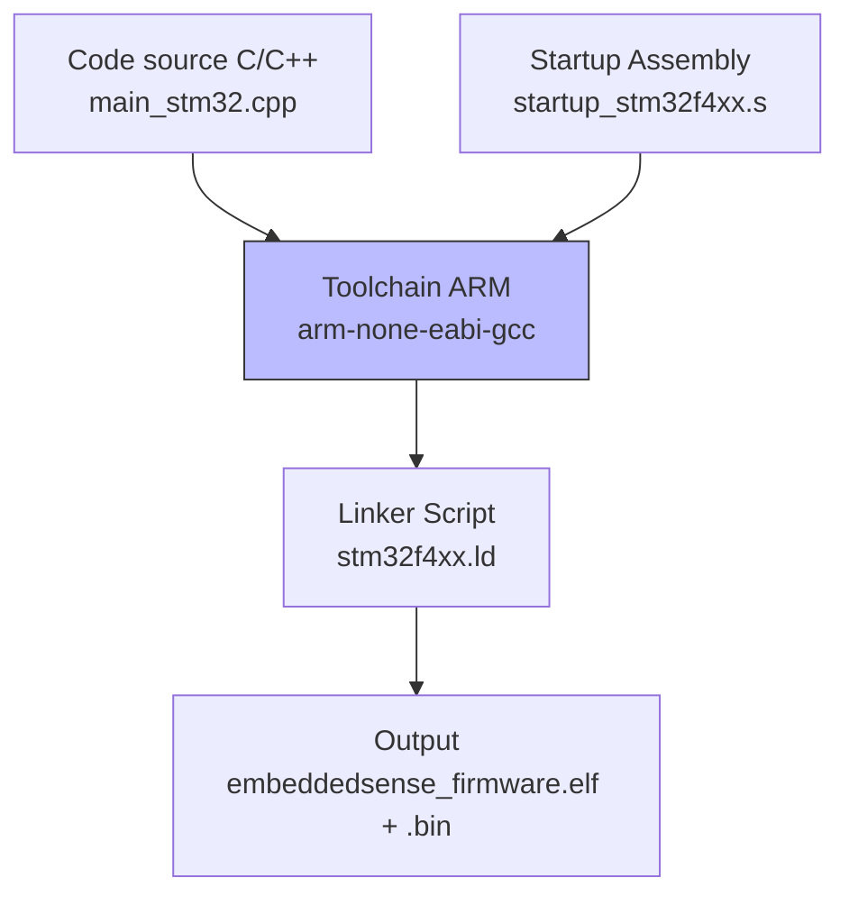
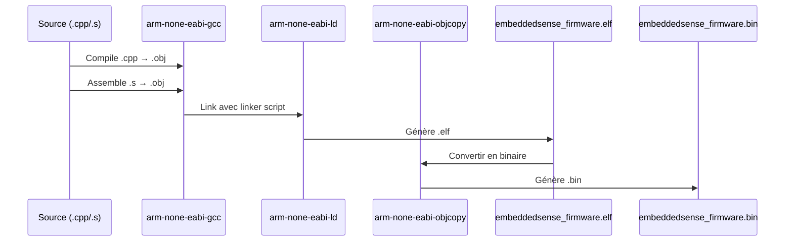

# Phase 8 - Préparation STM32 (Documentation détaillée)

**Statut** : ✅ Validée
**Date** : 10 Novembre 2026
**Tests** : Cross-compilation réussie (100 bytes .bin généré)

---

## 📋 Table des matières

1. [Objectif](#objectif)
2. [Architecture](#architecture)
3. [Notions clés](#notions-clés)
4. [Installation du toolchain ARM](#installation-du-toolchain-arm)
5. [Linker script (.ld)](#linker-script-ld)
6. [Startup assembly (.s)](#startup-assembly-s)
7. [Toolchain CMake (toolchain-arm.cmake)](#toolchain-cmake)
8. [CMakeLists.txt — Cross-compilation](#cmakeliststxt--cross-compilation)
9. [Validation](#validation)
10. [Ce qu'on a appris](#ce-quon-a-appris)
11. [Prochaines étapes](#prochaines-étapes)

---

## Objectif

Installer les outils de **cross-compilation** pour STM32, configurer un **toolchain ARM**, et valider qu'on peut compiler pour le microcontrôleur (même sans le brancher).

### Résultat

```
   text	   data	    bss	    dec	    hex	filename
    100	      0	      0	    100	     64	embeddedsense_firmware.elf
```

**Fichiers générés :**
- `embeddedsense_firmware.elf` (100 bytes) — Exécutable ELF pour ARM Cortex-M4
- `embeddedsense_firmware.bin` (100 bytes) — Binaire brut pour flashage

---

## Architecture



### Flux de compilation



---

## Notions clés

### 1. Cross-compilation

**Cross-compilation** = compiler sur une architecture (x86, PC) pour une autre architecture (ARM, STM32).

| Compilation native | Cross-compilation |
|-------------------|-------------------|
| `gcc` (x86 → x86) | `arm-none-eabi-gcc` (x86 → ARM) |
| Le code tourne sur ton PC | Le code tourne sur la carte |
| Bibliothèques standard disponibles | Pas de bibliothèques standard (bare-metal) |

### 2. Toolchain ARM

Un **toolchain** est l'ensemble des outils nécessaires pour compiler pour une architecture donnée :

| Outil | Rôle |
|-------|------|
| `arm-none-eabi-gcc` | Compilateur C/C++ |
| `arm-none-eabi-g++` | Compilateur C++ |
| `arm-none-eabi-as` | Assembleur |
| `arm-none-eabi-ld` | Linker |
| `arm-none-eabi-objcopy` | Convertisseur de format (.elf → .bin) |
| `arm-none-eabi-readelf` | Lecteur de fichiers ELF |
| `arm-none-eabi-size` | Taille des sections |

### 3. Linker script (.ld)

Le **linker script** définit comment la mémoire est organisée dans la puce :
- **FLASH** : où le code est stocké (0x08000000)
- **RAM** : où les données sont stockées (0x20000000)
- **Sections** : .text (code), .data (données init.), .bss (données non init.)

### 4. Startup assembly (.s)

Le **startup** est le code qui s'exécute au démarrage du microcontrôleur :
1. Copier les données initialisées de Flash vers RAM
2. Remplir la section BSS avec des zéros
3. Appeler `main()`

### 5. Bare-metal

**Bare-metal** = sans système d'exploitation. Le code tourne directement sur le hardware. Pas de `main()` standard, pas de bibliothèques standard.

---

## Installation du toolchain ARM

### Via MSYS2 (recommandé)

```bash
pacman -S mingw-w64-x86_64-arm-none-eabi-gcc
pacman -S mingw-w64-x86_64-arm-none-eabi-newlib
pacman -S mingw-w64-x86_64-arm-none-eabi-binutils
```

### Vérification

```bash
arm-none-eabi-gcc --version
# arm-none-eabi-gcc (GCC) 13.3.0
```

---

## Linker script (.ld)

### Fichier : `platform/stm32/stm32f4xx.ld`

```ld
MEMORY
{
    RAM (xrw)  : ORIGIN = 0x20000000, LENGTH = 128K
    FLASH (rx) : ORIGIN = 0x08000000, LENGTH = 512K
}

SECTIONS
{
    .text : {
        *(.isr_vector)
        *(.text)
        *(.text*)
        *(.rodata)
        *(.rodata*)
        . = ALIGN(4);
        _etext = .;
    } > FLASH

    .data : AT(_etext) {
        _sdata = .;
        *(.data)
        *(.data*)
        . = ALIGN(4);
        _edata = .;
    } > RAM

    .bss : {
        _sbss = .;
        *(.bss)
        *(.bss*)
        *(COMMON)
        . = ALIGN(4);
        _ebss = .;
    } > RAM

    _estack = ORIGIN(RAM) + LENGTH(RAM);
}
```

### Explication

| Section | Destination | Contenu |
|---------|-------------|---------|
| `.text` | FLASH (0x08000000) | Code et constantes |
| `.data` | RAM (0x20000000) | Données initialisées (copiées depuis Flash) |
| `.bss` | RAM | Données non initialisées (remplies de zéros) |
| `_estack` | Fin de RAM | Pointeur de pile |

**Symboles définis :**
- `_etext` : Fin du code en Flash
- `_sdata`, `_edata` : Début et fin de .data en RAM
- `_sbss`, `_ebss` : Début et fin de .bss en RAM
- `_estack` : Pointeur de pile (fin de la RAM)

---

## Startup assembly (.s)

### Fichier : `platform/stm32/startup_stm32f4xx.s`

```asm
.syntax unified
.cpu cortex-m4
.thumb

.global Reset_Handler
.global g_pfnVectors

.section .isr_vector, "a", %progbits
.type g_pfnVectors, %object
g_pfnVectors:
    .word _estack
    .word Reset_Handler

.section .text, "ax", %progbits
.type Reset_Handler, %function
Reset_Handler:
    /* Copier .data de Flash vers RAM */
    ldr r0, =_sdata
    ldr r1, =_edata
    ldr r2, =_etext
    movs r3, #0
LoopCopy:
    cmp r0, r1
    bge EndCopy
    ldr r4, [r2, r3]
    str r4, [r0, r3]
    adds r3, r3, #4
    adds r0, r0, #4
    b LoopCopy
EndCopy:

    /* Remplir .bss avec des zéros */
    ldr r0, =_sbss
    ldr r1, =_ebss
    movs r2, #0
LoopZero:
    cmp r0, r1
    bge EndZero
    str r2, [r0]
    adds r0, r0, #4
    b LoopZero
EndZero:

    /* Appeler main() */
    bl main
    b .
```

### Explication

| Étape | Description |
|-------|-------------|
| `g_pfnVectors` | Table des vecteurs d'interruption (pointeur de pile + Reset_Handler) |
| Copier .data | Copie les données initialisées de Flash vers RAM |
| Remplir .bss | Met les données non initialisées à zéro |
| `bl main` | Appelle la fonction main() |
| `b .` | Boucle infinie si main() retourne |

---

## Toolchain CMake

### Fichier : `platform/stm32/toolchain-arm.cmake`

```cmake
# Ajouter les chemins MSYS2 au PATH
set(ENV{PATH} "C:/msys64/mingw64/bin;C:/msys64/usr/bin;$ENV{PATH}")

set(CMAKE_SYSTEM_NAME Generic)
set(CMAKE_SYSTEM_PROCESSOR arm)

set(CMAKE_C_COMPILER "C:/msys64/mingw64/bin/arm-none-eabi-gcc.exe")
set(CMAKE_CXX_COMPILER "C:/msys64/mingw64/bin/arm-none-eabi-g++.exe")
set(CMAKE_ASM_COMPILER "C:/msys64/mingw64/bin/arm-none-eabi-gcc.exe")

# Flags pour Cortex-M4 (STM32F4)
set(CMAKE_C_FLAGS_INIT "-mcpu=cortex-m4 -mthumb -mfloat-abi=soft")
set(CMAKE_CXX_FLAGS_INIT "-mcpu=cortex-m4 -mthumb -mfloat-abi=soft")
set(CMAKE_ASM_FLAGS_INIT "-mcpu=cortex-m4 -mthumb -x assembler-with-cpp")

set(CMAKE_FIND_ROOT_PATH "C:/msys64/mingw64")
set(CMAKE_FIND_ROOT_PATH_MODE_PROGRAM NEVER)
set(CMAKE_FIND_ROOT_PATH_MODE_LIBRARY ONLY)
set(CMAKE_FIND_ROOT_PATH_MODE_INCLUDE ONLY)
set(CMAKE_FIND_ROOT_PATH_MODE_PACKAGE ONLY)

set(CMAKE_TRY_COMPILE_TARGET_TYPE STATIC_LIBRARY)
```

### Points clés

- `CMAKE_SYSTEM_NAME Generic` : indique que c'est un système embarqué (pas Linux/Windows)
- `CMAKE_TRY_COMPILE_TARGET_TYPE STATIC_LIBRARY` : évite de linker un exécutable (qui échouerait en bare-metal)
- `-mcpu=cortex-m4` : cible le Cortex-M4 (STM32F4)
- `-mthumb` : utilise le jeu d'instructions Thumb (plus compact)
- `-mfloat-abi=soft` : utilise l'émulation logicielle pour les flottants (pas de FPU matérielle)

---

## CMakeLists.txt — Cross-compilation

### Modifications apportées

```cmake
cmake_minimum_required(VERSION 3.14)

option(CROSS_COMPILE "Build for STM32 (ARM)" OFF)

if(CROSS_COMPILE)
    set(CMAKE_TOOLCHAIN_FILE "${CMAKE_CURRENT_SOURCE_DIR}/platform/stm32/toolchain-arm.cmake" CACHE FILEPATH "Toolchain file")
    include("${CMAKE_CURRENT_SOURCE_DIR}/platform/stm32/toolchain-arm.cmake")
endif()

project(EmbeddedSense C CXX ASM)

# ... (Google Test seulement pour PC)

if(CROSS_COMPILE)
    add_executable(embeddedsense_firmware
        app/main_stm32.cpp
        platform/stm32/startup_stm32f4xx.s
    )
    target_link_options(embeddedsense_firmware PRIVATE
        -T${CMAKE_CURRENT_SOURCE_DIR}/platform/stm32/stm32f4xx.ld
        -nostdlib
        -e Reset_Handler
    )
    set_target_properties(embeddedsense_firmware PROPERTIES SUFFIX ".elf")

    add_custom_command(TARGET embeddedsense_firmware POST_BUILD
        COMMAND C:/msys64/mingw64/bin/arm-none-eabi-objcopy.exe -O binary $<TARGET_FILE:embeddedsense_firmware> ${CMAKE_BINARY_DIR}/embeddedsense_firmware.bin
        COMMENT "Generating .bin file"
    )
endif()
```

### Commandes de build

```bash
# Configurer
cmake -G "MSYS Makefiles" -DCMAKE_TOOLCHAIN_FILE="path/to/toolchain-arm.cmake" -DCROSS_COMPILE=ON -S . -B build_stm32

# Compiler
cmake --build build_stm32

# Résultat
# build_stm32/embeddedsense_firmware.elf
# build_stm32/embeddedsense_firmware.bin
```

---

## Validation

### Résultat de la compilation

```
   text	   data	    bss	    dec	    hex	filename
    100	      0	      0	    100	     64	embeddedsense_firmware.elf
```

| Fichier | Taille | Description |
|---------|--------|-------------|
| `embeddedsense_firmware.elf` | 100 bytes | Exécutable ELF pour ARM Cortex-M4 |
| `embeddedsense_firmware.bin` | 100 bytes | Binaire brut pour flashage |

### Vérification du fichier ELF

```bash
arm-none-eabi-readelf -h embeddedsense_firmware.elf
# Class: ELF32
# Machine: ARM
# Entry point: 0x8000000 (début de la Flash)
```

---

## Ce qu'on a appris

### Compétences acquises

1. **Cross-compilation** : Compiler pour une architecture différente de la machine hôte
2. **Toolchain ARM** : `arm-none-eabi-gcc`, `arm-none-eabi-g++`, `arm-none-eabi-objcopy`
3. **Linker script** : Définir la mémoire (FLASH, RAM) et les sections (.text, .data, .bss)
4. **Startup assembly** : Code d'initialisation (copie .data, zero .bss, appel main)
5. **CMake cross-compilation** : Toolchain file, `CMAKE_SYSTEM_NAME`, `CMAKE_TRY_COMPILE_TARGET_TYPE`
6. **Bare-metal** : Compilation sans OS ni bibliothèques standard
7. **Cortex-M4** : Architecture ARM, jeu d'instructions Thumb, FPU

### Points d'attention pour l'embarqué

- **Le linker script** doit correspondre à la carte (adresses FLASH/RAM)
- **Le startup** doit initialiser correctement la pile et les sections
- **Les flags** `-mcpu`, `-mthumb`, `-mfloat-abi` doivent correspondre au hardware
- **Le .bin** est le fichier à flasher sur la carte (via ST-Link, OpenOCD, etc.)
- **Les chemins avec espaces** peuvent poser problème (utiliser des chemins sans espaces si possible)

---

## Prochaines étapes

La **Phase 9** consistera à :
1. Générer un projet STM32CubeMX
2. Remplacer les implémentations Host par les vraies implémentations STM32
3. Implémenter les drivers réels (ADC, UART, LED)
4. Configurer FreeRTOS pour STM32
5. Flasher et tester sur une vraie carte

---

## Commandes de référence

```bash
# Configurer (cross-compilation)
cmake -G "MSYS Makefiles" -DCMAKE_TOOLCHAIN_FILE="path/to/toolchain-arm.cmake" -DCROSS_COMPILE=ON -S . -B build_stm32

# Compiler
cmake --build build_stm32

# Vérifier le .elf
arm-none-eabi-readelf -h build_stm32/embeddedsense_firmware.elf
arm-none-eabi-size build_stm32/embeddedsense_firmware.elf

# Flasher (via st-flash)
st-flash write build_stm32/embeddedsense_firmware.bin 0x08000000
```

---

