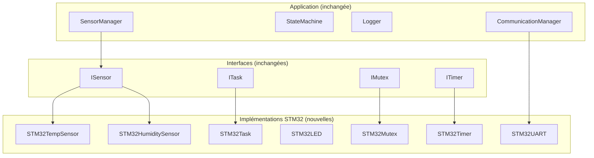

# Phase 9 - Portage STM32 réel (Documentation détaillée)

**Statut** : ✅ Code créé (compilation nécessite le HAL STM32 + FreeRTOS)
**Date** : 10 Novembre 2026

---

## 📋 Table des matières

1. [Objectif](#objectif)
2. [Architecture](#architecture)
3. [Notions clés](#notions-clés)
4. [Drivers STM32](#drivers-stm32)
5. [Platform wrappers (STM32Task, STM32Mutex, STM32Timer)](#platform-wrappers)
6. [FreeRTOSConfig.h](#freertosconfigh)
7. [Fichiers créés](#fichiers-créés)
8. [Ce qu'on a appris](#ce-quon-a-appris)
9. [Prochaines étapes](#prochaines-étapes)

---

## Objectif

Remplacer les implémentations PC (Host) par les **vraies implémentations STM32** (HAL + FreeRTOS), et préparer le code pour tourner sur une vraie carte STM32.

### Ce qui change entre PC et STM32

| Composant PC | Composant STM32 | API |
|-------------|-----------------|-----|
| `HostTask` (std::thread) | `STM32Task` (FreeRTOS) | `xTaskCreate` |
| `HostMutex` (std::mutex) | `STM32Mutex` (FreeRTOS) | `xSemaphoreCreateMutex` |
| `HostTimer` (std::chrono) | `STM32Timer` (FreeRTOS) | `xTimerCreate` |
| `MockTemperatureSensor` | `STM32TempSensor` | HAL ADC |
| `MockHumiditySensor` | `STM32HumiditySensor` | HAL ADC |
| `MockUART` | `STM32UART` | HAL UART |
| (pas de LED) | `STM32LED` | HAL GPIO |

---

## Architecture



### Principe : L'application ne change pas

Grâce à la couche d'abstraction (Phase 6), le code applicatif (`SensorManager`, `StateMachine`, etc.) **ne change pas**. Seules les implémentations concrètes sont remplacées.

```
Phase 5 (PC) :  app → ITask → HostTask (std::thread)
Phase 9 (STM32) : app → ITask → STM32Task (FreeRTOS)
```

---

## Notions clés

### 1. STM32 HAL (Hardware Abstraction Layer)

Le **HAL** est la bibliothèque officielle STMicroelectronics pour interagir avec le hardware :

| Périphérique | HAL API | Usage |
|-------------|---------|-------|
| ADC | `HAL_ADC_Start`, `HAL_ADC_GetValue` | Lire les capteurs analogiques |
| UART | `HAL_UART_Transmit`, `HAL_UART_Receive` | Communication série |
| GPIO | `HAL_GPIO_WritePin`, `HAL_GPIO_ReadPin` | Contrôler les LEDs/boutons |
| Timer | `HAL_TIM_Base_Start` | Timer pour FreeRTOS tick |

### 2. FreeRTOS sur STM32

FreeRTOS est intégré dans le projet STM32 via CubeMX :
- **Tâches** : `xTaskCreate()` crée une tâche FreeRTOS
- **Mutex** : `xSemaphoreCreateMutex()` crée un mutex
- **Timers** : `xTimerCreate()` crée un timer logiciel
- **Délai** : `vTaskDelay()` met la tâche en attente

### 3. ADC (Analog-to-Digital Converter)

L'ADC convertit un signal analogique (0-3.3V) en valeur numérique (0-4095 pour 12 bits) :

```
Tension (V) = (ADC_value × 3.3) / 4095
```

### 4. Flash & Debug

- **Flash** : Écrire le programme dans la mémoire Flash du STM32
- **ST-Link** : Interface de debug/flashage
- **OpenOCD** : Outil open-source pour flasher et déboguer

---

## Drivers STM32

### STM32TempSensor

**Fichier :** `drivers/stm32/STM32TempSensor.hpp/.cpp`

```cpp
class STM32TempSensor : public ISensor {
private:
    ADC_HandleTypeDef* hadc;
    uint32_t channel;
    double calibrationOffset;

public:
    STM32TempSensor(ADC_HandleTypeDef* hadc, uint32_t channel, double offset = 0.0);
    double read() override;  // Lit l'ADC, convertit en °C
    std::string getName() override;  // Retourne "Temperature"
};
```

**Implémentation de `read()` :**
1. Configurer le canal ADC
2. Lancer la conversion (`HAL_ADC_Start`)
3. Attendre la fin (`HAL_ADC_PollForConversion`)
4. Lire la valeur (`HAL_ADC_GetValue`)
5. Convertir en température (ex: LM35, 10mV/°C)

### STM32HumiditySensor

**Fichier :** `drivers/stm32/STM32HumiditySensor.hpp/.cpp`

Même principe que le capteur de température, mais la conversion est différente (ex: HIH-4000, formule spécifique).

### STM32UART

**Fichier :** `drivers/stm32/STM32UART.hpp/.cpp`

```cpp
class STM32UART {
private:
    UART_HandleTypeDef* huart;
    std::queue<std::string> rxBuffer;

public:
    STM32UART(UART_HandleTypeDef* huart);
    void send(const std::string& data);      // HAL_UART_Transmit
    std::string receive();                   // Lit rxBuffer
    void onReceiveComplete(uint8_t* data, size_t len);  // Callback IT
};
```

**Utilise** les interruptions UART pour la réception asynchrone.

### STM32LED

**Fichier :** `drivers/stm32/STM32LED.hpp/.cpp`

```cpp
class STM32LED {
private:
    GPIO_TypeDef* port;
    uint16_t pin;

public:
    STM32LED(GPIO_TypeDef* port, uint16_t pin);
    void on();      // HAL_GPIO_WritePin(port, pin, GPIO_PIN_SET)
    void off();     // HAL_GPIO_WritePin(port, pin, GPIO_PIN_RESET)
    void toggle();  // HAL_GPIO_TogglePin(port, pin)
};
```

---

## Platform wrappers

### STM32Task

**Fichier :** `platform/stm32/STM32Task.hpp/.cpp`

```cpp
class STM32Task : public ITask {
private:
    TaskHandle_t handle = nullptr;
    std::function<void()> taskFunc;
    const char* name;
    uint16_t stackSize;
    UBaseType_t priority;

    static void taskWrapper(void* param);

public:
    STM32Task(std::function<void()> func, const char* name, uint16_t stackSize = 256, UBaseType_t priority = 1);
    ~STM32Task();
    void start() override;   // xTaskCreate
    void stop() override;    // vTaskDelete
    bool isRunning() const override;
};
```

**Implémentation de `start()` :**
```cpp
void STM32Task::start() {
    if (handle == nullptr) {
        xTaskCreate(taskWrapper, name, stackSize, this, priority, &handle);
    }
}
```

### STM32Mutex

**Fichier :** `platform/stm32/STM32Mutex.hpp/.cpp`

```cpp
class STM32Mutex : public IMutex {
private:
    SemaphoreHandle_t handle;

public:
    STM32Mutex();   // xSemaphoreCreateMutex
    ~STM32Mutex();  // vSemaphoreDelete
    void lock() override;    // xSemaphoreTake
    void unlock() override;  // xSemaphoreGive
};
```

### STM32Timer

**Fichier :** `platform/stm32/STM32Timer.hpp/.cpp`

```cpp
class STM32Timer : public ITimer {
private:
    TimerHandle_t handle = nullptr;
    uint32_t periodMs = 0;
    bool expired = false;

    static void timerCallback(TimerHandle_t xTimer);

public:
    STM32Timer();
    ~STM32Timer();
    void start(uint32_t periodMs) override;  // xTimerCreate + xTimerStart
    void stop() override;                     // xTimerStop + xTimerDelete
    bool hasExpired() const override;
};
```

---

## FreeRTOSConfig.h

### Fichier : `platform/stm32/FreeRTOSConfig.h`

```c
#define configUSE_PREEMPTION                    1
#define configCPU_CLOCK_HZ                      168000000
#define configTICK_RATE_HZ                      1000
#define configMAX_PRIORITIES                    5
#define configMINIMAL_STACK_SIZE                128
#define configTOTAL_HEAP_SIZE                   (32 * 1024)
#define configUSE_MUTEXES                       1
#define configUSE_TIMERS                        1
#define configCHECK_FOR_STACK_OVERFLOW          2
```

**Paramètres clés :**

| Paramètre | Valeur | Description |
|-----------|--------|-------------|
| `configCPU_CLOCK_HZ` | 168000000 | Fréquence CPU (168 MHz pour STM32F4) |
| `configTICK_RATE_HZ` | 1000 | 1 tick = 1ms |
| `configMAX_PRIORITIES` | 5 | 5 niveaux de priorité |
| `configTOTAL_HEAP_SIZE` | 32 KB | Mémoire pour FreeRTOS |
| `configUSE_MUTEXES` | 1 | Activer les mutex |
| `configUSE_TIMERS` | 1 | Activer les timers logiciels |

---

## Fichiers créés

### Structure des dossiers

```
drivers/
└── stm32/
    ├── STM32TempSensor.hpp/.cpp
    ├── STM32HumiditySensor.hpp/.cpp
    ├── STM32UART.hpp/.cpp
    └── STM32LED.hpp/.cpp

platform/
└── stm32/
    ├── STM32Task.hpp/.cpp
    ├── STM32Mutex.hpp/.cpp
    ├── STM32Timer.hpp/.cpp
    └── FreeRTOSConfig.h
```

### Détail des fichiers

| Fichier | Lignes | Rôle |
|---------|--------|------|
| `STM32TempSensor.hpp/.cpp` | ~40 | Capteur température ADC |
| `STM32HumiditySensor.hpp/.cpp` | ~35 | Capteur humidité ADC |
| `STM32UART.hpp/.cpp` | ~45 | Communication série |
| `STM32LED.hpp/.cpp` | ~25 | Contrôle LED |
| `STM32Task.hpp/.cpp` | ~45 | Tâche FreeRTOS |
| `STM32Mutex.hpp/.cpp` | ~25 | Mutex FreeRTOS |
| `STM32Timer.hpp/.cpp` | ~40 | Timer FreeRTOS |
| `FreeRTOSConfig.h` | ~40 | Configuration FreeRTOS |

---

## Ce qu'on a appris

### Compétences acquises

1. **STM32 HAL** : ADC, UART, GPIO
2. **FreeRTOS** : xTaskCreate, xSemaphoreCreateMutex, xTimerCreate
3. **ADC** : Conversion analogique → numérique
4. **UART** : Communication série avec interruptions
5. **GPIO** : Contrôle des LEDs
6. **Portage** : Remplacer les implémentations sans changer l'application

### Patterns de design utilisés

| Pattern | Description |
|---------|-------------|
| **Adapter** | STM32Task adapte FreeRTOS à ITask |
| **Strategy** | HostTask vs STM32Task sont interchangeables |
| **HAL** | Abstraction du hardware via la bibliothèque ST |

---

## Prochaines étapes

La **Phase 10** consistera à :
1. Nettoyer le code (clang-format, commentaires Doxygen)
2. Compiler avec `-Wall -Wextra -Werror`
3. Créer la démo sur la carte STM32
4. Mettre à jour le README
5. Créer le tag Git `v1.0.0`

---

